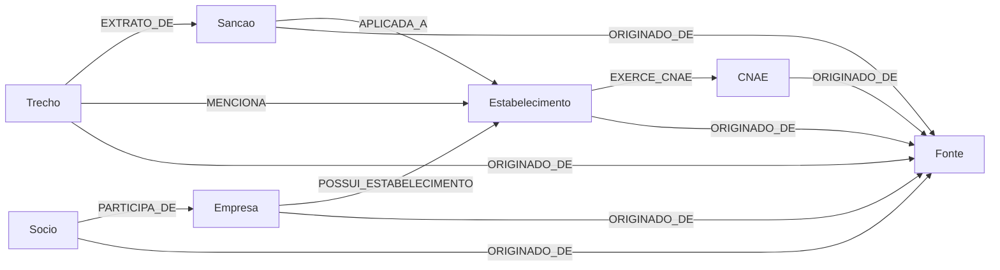

# FiscalGraph BR — Modelagem conceitual LPG

> **Status:** versão de trabalho consolidada para a Tarefa 3, baseada no contrato canónico de dados documentado pelo Dev 2.  
> **Escopo:** núcleo do grafo para rastreabilidade societária, consulta cadastral, associação explicável de registos CEIS/CNEP e extensão Text-to-Graph com trechos textuais.  
> **Integração:** antes do merge, conferir este documento com os CSVs versionados em `data/processed/canonical/` e com o schema Cypher da implementação.

---

## 1. Finalidade

O FiscalGraph BR utiliza um grafo de conhecimento para conectar informações públicas cadastrais de pessoas jurídicas a registos públicos de sanções administrativas, preservando a origem dos dados e os critérios utilizados para estabelecer cada ligação.

A modelagem separa a pessoa jurídica, identificada pela raiz do CNPJ, dos seus estabelecimentos, identificados pelo CNPJ completo. Também representa os registos do Quadro de Sócios e Administradores (QSA), as atividades económicas CNAE, os registos de compliance provenientes do CEIS e do CNEP, as passagens textuais de fundamentação/publicação (`Trecho`) e as fontes utilizadas na recolha.

O grafo deve permitir consultas explicáveis: para cada informação ou caminho apresentado, o sistema deve indicar os nós, os relacionamentos, os identificadores usados e as fontes que sustentam a conexão.

**Limite interpretativo:** vínculo societário, coincidência de nome, presença em cadastro público ou menção textual não constitui, isoladamente, prova de fraude, sonegação, responsabilidade de terceiros ou irregularidade atual. O grafo organiza factos publicados nas fontes e caminhos entre registos; não substitui análise jurídica ou investigação.

## 2. Escopo e base de dados

### 2.1. Arquivos canónicos e dados textuais

O modelo considera os sete ficheiros CSV produzidos pelo pipeline do Dev 2, complementados pela modelagem de evidências textuais:

| Arquivo / Origem | Conteúdo | Papel no grafo |
|---|---|---|
| `empresas.csv` | Dados cadastrais da pessoa jurídica pela raiz do CNPJ | Nós `Empresa` |
| `estabelecimentos.csv` | Matriz e filiais, identificadas pelo CNPJ completo | Nós `Estabelecimento` |
| `socios.csv` | Registos do QSA associados à raiz do CNPJ | Nós `Socio` e relações `PARTICIPA_DE` |
| `cnaes.csv` | Códigos e descrições de atividades económicas | Nós `CNAE` |
| `estabelecimento_cnaes.csv` | Associação entre CNPJ do estabelecimento e código CNAE | Relações `EXERCE_CNAE` |
| `compliance.csv` | Registos de pessoa jurídica extraídos do CEIS e do CNEP | Nós `Sancao` e relações `APLICADA_A` |
| `fontes.csv` | Identificação, URL, competência e dados de recolha das bases | Nós `Fonte` |
| Extratos / Publicações (Dev 4) | Passagens textuais e fundamentações de sanções | Nós `Trecho` e relações `EXTRATO_DE`, `ORIGINADO_DE`, `MENCIONA` |

`estabelecimento_cnaes.csv` representa uma associação entre entidades. Os seus registos são convertidos em relacionamentos com propriedades, não em nós independentes.

### 2.2. Fontes documentadas

- **Receita Federal do Brasil (RFB):** dados cadastrais de empresas, estabelecimentos e QSA consumidos via serviço intermediário de espelho de dados abertos.
- **Controladoria-Geral da União (CGU) — CEIS:** Cadastro de Empresas Inidóneas e Suspensas.
- **Controladoria-Geral da União (CGU) — CNEP:** Cadastro Nacional de Empresas Punidas.
- **Instituto Brasileiro de Geografia e Estatística (IBGE/CONCLA):** códigos e descrições da CNAE.

Os identificadores internos `fonte_id` são preservados e usados para conectar os registos ao nó `Fonte`. URL, competência, data de recolha e ficheiro de origem devem ser mantidos para auditoria da procedência.

### 2.3. Recorte da amostra

A documentação de fontes do Dev 2 e o relatório de execução `build_report.json` registam uma amostra canónica representativa de **18 empresas completas**, com estabelecimentos, sócios, CNAEs e registos de compliance associados (54 sanções, sendo 30 do CEIS e 24 do CNEP), com 100% de correspondência cadastral pelo CNPJ completo.

Registos de sanções aplicadas a pessoas físicas foram excluídos do conjunto canónico para cumprimento estrito das diretrizes de privacidade e minimização.

---

## 3. Princípios de modelagem

1. **Granularidade empresarial:** `Empresa` representa a pessoa jurídica pela raiz do CNPJ; `Estabelecimento` representa cada unidade identificada pelo CNPJ completo.
2. **Identificadores como texto:** CNPJ básico, CNPJ completo e códigos que possam conter zeros à esquerda devem ser armazenados como strings.
3. **CNPJ alfanumérico:** aceitar oito carateres alfanuméricos para o CNPJ básico e doze carateres alfanuméricos seguidos de dois dígitos numéricos para o CNPJ completo.
4. **Identidade de sócios conservadora:** `socio_id` é uma chave técnica da ocorrência no QSA com escopo restrito à empresa; não deduplica sócios entre empresas.
5. **Associação de sanções por identificador:** criar `APLICADA_A` somente quando `cnpj_sancionado` corresponder exatamente a `Estabelecimento.cnpj`. Não usar similaridade textual.
6. **Integração Text-to-Graph cautelosa:** o nó `Trecho` referencia passagens textuais oficiais. A relação `MENCIONA` indica exclusivamente citação textual candidata de CNPJ, não configurando presunção de responsabilidade.
7. **Proveniência preservada:** manter `fonte_id`, `registro_origem`, competência, data de recolha, URL e ficheiro de origem em todas as entidades.
8. **Ausência não é evidência negativa:** a ausência de registo no recorte não prova inexistência de sanções em toda a base pública.
9. **Fato e inferência separados:** distinguir dados publicados pela fonte das conclusões obtidas ao percorrer múltiplos relacionamentos.

---

## 4. Entidades (nós) e propriedades

### 4.1. `Empresa`

**Identificador:** `cnpj_basico` (oito carateres).

| Propriedade | Origem | Descrição |
|---|---|---|
| `cnpj_basico` | `empresas.csv` | Chave da pessoa jurídica |
| `razao_social` | `empresas.csv` | Razão social |
| `natureza_juridica` | `empresas.csv` | Natureza jurídica |
| `porte` | `empresas.csv` | Porte empresarial |
| `capital_social` | `empresas.csv` | Capital social declarado |

### 4.2. `Estabelecimento`

**Identificador:** `cnpj` (14 carateres no formato estrutural do CNPJ).

| Propriedade | Origem | Descrição |
|---|---|---|
| `cnpj` | `estabelecimentos.csv` | Chave do estabelecimento |
| `cnpj_basico` | `estabelecimentos.csv` | Raiz da pessoa jurídica à qual pertence |
| `nome_fantasia` | `estabelecimentos.csv` | Nome de fantasia, quando informado |
| `situacao_cadastral` | `estabelecimentos.csv` | Situação cadastral publicada |
| `data_inicio_atividade` | `estabelecimentos.csv` | Data de início da atividade |
| `uf` | `estabelecimentos.csv` | Unidade federativa |
| `municipio` | `estabelecimentos.csv` | Município conforme o dado canónico |

### 4.3. `Socio`

**Identificador técnico:** `socio_id`. Identifica a ocorrência local do sócio no snapshot da empresa.

| Propriedade | Origem | Descrição |
|---|---|---|
| `socio_id` | `socios.csv` | Identificador técnico do registo (`SOC-` + hash) |
| `nome` | `socios.csv` | Nome publicado no QSA |
| `tipo_pessoa` | `socios.csv` | `PESSOA FISICA` ou `PESSOA JURIDICA` |
| `qualificacao` | `socios.csv` | Qualificação do sócio no QSA |
| `data_entrada` | `socios.csv` | Data de entrada na sociedade |

### 4.4. `CNAE`

**Identificador:** `codigo`.

| Propriedade | Origem | Descrição |
|---|---|---|
| `codigo` | `cnaes.csv` | Código CNAE |
| `descricao` | `cnaes.csv` | Descrição oficial da atividade económica |

### 4.5. `Sancao`

**Identificador:** `registro_id`.

| Propriedade | Origem | Descrição |
|---|---|---|
| `registro_id` | `compliance.csv` | Identificador do registo canónico (ex: `CEIS-132342`) |
| `tipo_registro` | `compliance.csv` | Cadastro de origem: `CEIS` ou `CNEP` |
| `orgao_responsavel` | `compliance.csv` | Órgão sancionador informado |
| `numero_processo` | `compliance.csv` | Número do processo administrativo |
| `data_inicio` | `compliance.csv` | Data de início da penalidade |
| `data_fim` | `compliance.csv` | Data final, quando informada |
| `situacao` | `compliance.csv` | Abrangência da sanção conforme a fonte |
| `descricao` | `compliance.csv` | Categoria/modalidade da sanção |
| `observacoes` | `compliance.csv` | Observações publicadas |
| `fundamentacao_legal` | `compliance.csv` | Dispositivo legal referenciado |
| `cnpj_sancionado` | `compliance.csv` | CNPJ da pessoa jurídica sancionada |
| `url_fonte` | `compliance.csv` | URL pública do conjunto de dados |

### 4.6. `Fonte`

**Identificador:** `fonte_id`.

| Propriedade | Origem | Descrição |
|---|---|---|
| `fonte_id` | `fontes.csv` | Identificador interno da fonte (ex: `F-CGU-CEIS`) |
| `nome` | `fontes.csv` | Nome do conjunto de dados |
| `orgao_responsavel` | `fontes.csv` | Órgão responsável |
| `url` | `fontes.csv` | URL de consulta ou obtenção |
| `data_coleta` | `fontes.csv` | Data e hora da recolha (ISO-8601) |
| `competencia` | `fontes.csv` | Competência ou referência temporal |
| `arquivo_origem` | `fontes.csv` | Ficheiro utilizado na ingestão |

### 4.7. Trecho

Representa uma passagem textual delimitada (parágrafo, ementa, despacho ou extrato) originada de um documento, publicação ou registo oficial de compliance. Esse nó viabiliza a integração Text-to-Graph, servindo de base para auditoria explicável e recuperação contextual via GraphRAG.

| Propriedade | Tipo | Obrigatório? | Descrição / Exemplo |
|---|---|---|---|
| `trecho_id` | String | Sim | Identificador único estável do trecho (ex: `TR-CEIS-132342-01`). Chave exclusiva. |
| `texto` | String | Sim | Conteúdo textual extraído da publicação ou registo oficial de compliance. |
| `registro_id` | String | Sim | Identificador do registo de sanção de origem ao qual o trecho pertence. |
| `fonte_id` | String | Sim | Identificador da fonte primária mantenedora do documento (ex: `F-CGU-CEIS`). |
| `url_fonte` | String | Não | URL pública direta ou de consulta do conjunto de dados de origem. |
| `registro_origem` | String | Não | Identificador ou linha de referência original na fonte. |
| `metodo_extracao` | String | Sim | Identificação da estratégia/algoritmo utilizado para extração do trecho. |
| `mencoes_json` | String | Não | Serialização JSON das menções textuais estruturadas extraídas da passagem. |

---

## 5. Relacionamentos

| Origem | Relacionamento | Destino | Fonte de construção | Regra |
|---|---|---|---|---|
| `Socio` | `PARTICIPA_DE` | `Empresa` | `socios.csv` | `Socio` pertence ao registo de QSA cujo `cnpj_basico` corresponde ao da empresa |
| `Empresa` | `POSSUI_ESTABELECIMENTO` | `Estabelecimento` | `estabelecimentos.csv` | `Empresa.cnpj_basico` = `Estabelecimento.cnpj_basico` |
| `Estabelecimento` | `EXERCE_CNAE` | `CNAE` | `estabelecimento_cnaes.csv` | Correspondência conjunta de `cnpj` e `codigo` |
| `Sancao` | `APLICADA_A` | `Estabelecimento` | `compliance.csv` | `Sancao.cnpj_sancionado` = `Estabelecimento.cnpj` |
| `Empresa` | `ORIGINADO_DE` | `Fonte` | `empresas.csv` | Correspondência de `fonte_id` |
| `Estabelecimento` | `ORIGINADO_DE` | `Fonte` | `estabelecimentos.csv` | Correspondência de `fonte_id` |
| `Socio` | `ORIGINADO_DE` | `Fonte` | `socios.csv` | Correspondência de `fonte_id` |
| `CNAE` | `ORIGINADO_DE` | `Fonte` | `cnaes.csv` | Correspondência de `fonte_id` |
| `Sancao` | `ORIGINADO_DE` | `Fonte` | `compliance.csv` | Correspondência de `fonte_id` |
| `Trecho` | `EXTRATO_DE` | `Sancao` | Pipeline Dev 4 | `registro_id` exato do registo de compliance ao qual o trecho pertence |
| `Trecho` | `ORIGINADO_DE` | `Fonte` | Pipeline Dev 4 | `fonte_id` exato da fonte institucional catalogada |
| `Trecho` | `MENCIONA` | `Estabelecimento` | Pipeline Dev 4 | CNPJ de 14 posições citado no texto idêntico a `Estabelecimento.cnpj`; atributo `status: "CANDIDATA"` |

> **Nota Metodológica sobre o relacionamento `MENCIONA`:**  
> A relação `MENCIONA` representa estritamente uma ocorrência textual candidata extraída da publicação, não constituindo por si só prova de vínculo jurídico, responsabilidade civil, administrativa ou solidariedade.

### 5.1. Propriedades dos relacionamentos

- **`PARTICIPA_DE`:** `qualificacao`, `data_entrada`, `registro_origem`.
- **`POSSUI_ESTABELECIMENTO`:** `registro_origem`, procedência.
- **`EXERCE_CNAE`:** `principal` (booleano), `registro_origem`.
- **`APLICADA_A`:** `registro_origem`, `cnpj_sancionado`.
- **`ORIGINADO_DE`:** `registro_origem` (não atribui propriedades excedentes).
- **`EXTRATO_DE`:** sem propriedades excedentes gravadas pelo loader (vínculo estrutural puro).
- **`MENCIONA`:** `status` (ex: `"CANDIDATA"`), `inicio` (posição de início do offset textual), `fim` (posição final do offset textual), `metodo` (método de reconhecimento textual).

### 5.2. Cardinalidades conceituais

| Relacionamento | Cardinalidade esperada |
|---|---|
| `Empresa` — `POSSUI_ESTABELECIMENTO` — `Estabelecimento` | Uma empresa pode possuir um ou vários estabelecimentos; cada estabelecimento pertence a uma raiz de CNPJ |
| `Socio` — `PARTICIPA_DE` — `Empresa` | Uma empresa pode ter vários registros de sócios; cada ocorrência de `Socio` do CSV está associada à empresa indicada no registro |
| `Estabelecimento` — `EXERCE_CNAE` — `CNAE` | Um estabelecimento pode estar associado a várias atividades; um CNAE pode estar associado a vários estabelecimentos |
| `Sancao` — `APLICADA_A` — `Estabelecimento` | Cada registro canônico de sanção aponta para o estabelecimento identificado pelo CNPJ informado |
| Entidade — `ORIGINADO_DE` — `Fonte` | Uma fonte pode originar muitos registros; cada registro canônico possui a fonte indicada em seu `fonte_id` |
| `Trecho` — `EXTRATO_DE` — `Sancao` | Uma sanção pode conter múltiplos trechos/extratos textuais; cada trecho referencia uma sanção de origem |
| `Trecho` — `MENCIONA` — `Estabelecimento` | Um trecho pode citar zero, um ou mais estabelecimentos (candidatos); um estabelecimento pode ser mencionado em múltiplos trechos |

---

## 6. Regras de identidade, normalização e associação

### 6.1. CNPJ

- `cnpj_basico`: oito carateres alfanuméricos como string.
- `cnpj`: 14 carateres estruturais como string.
- Remoção de pontuações, manutenção estrita de zeros à esquerda.
- CNPJ completo: doze carateres alfanuméricos seguidos de dois dígitos numéricos.

### 6.2. Associação de Sanção e Estabelecimento

O vínculo é criado exclusivamente quando `compliance.csv.cnpj_sancionado == estabelecimentos.csv.cnpj`. O caminho para alcançar a entidade legal básica é:

```text
(Sancao)-[:APLICADA_A]->(Estabelecimento)<-[:POSSUI_ESTABELECIMENTO]-(Empresa)
```

Esse caminho não equivale a uma sanção aplicada automaticamente a todos os estabelecimentos da raiz, nem autoriza inferir responsabilidade de sócios ou de outras empresas relacionadas.

### 6.3. Identidade dos Sócios

- Sem armazenamento de CPF bruto.
- `socio_id` é chave técnica local ao QSA da empresa (`cnpj_basico + index + nome`). Não fundir registos por homonímia nem afirmar identidade entre pessoas de empresas distintas sem identificador nacional validado.

### 6.4. Dados ausentes e temporalidade

- Campos vazios permanecem ausentes; não devem ser substituídos por valores inferidos.
- A ausência de `data_fim` não comprova vigência atual.
- A competência e a data de recolha devem ser consultadas em `Fonte`.

---

## 7. Consultas que o modelo deve suportar

1. **Perfil empresarial:** recuperar uma empresa por `cnpj_basico` e listar estabelecimentos, situação cadastral, localização e CNAEs.
2. **Quadro societário:** listar os registos de sócios associados a uma empresa, com qualificação, data de entrada e fonte.
3. **Registros de compliance:** identificar registos CEIS/CNEP associados a um estabelecimento por correspondência exata do CNPJ, apresentando modalidade, processo e fonte.
4. **Caminho societário explicável:** rastreabilidade de vínculos comprovados sem deduplicação arbitrária de nomes.
5. **Proveniência:** recuperar fonte, URL, competência, data de recolha e ficheiro que sustentam qualquer nó ou relação.
6. **Atividades económicas:** listar CNAEs principais e secundários de cada estabelecimento.
7. **Evidências textuais e menções candidatas:** recuperar trechos textuais relacionados a um registo de compliance (`Sancao`), exibir a fonte oficial e validar menções a estabelecimentos classificadas como candidatas:

```cypher
MATCH (s:Sancao {registro_id: $registro_id})<-[:EXTRATO_DE]-(t:Trecho)-[:ORIGINADO_DE]->(f:Fonte)
OPTIONAL MATCH (t)-[m:MENCIONA]->(e:Estabelecimento)
RETURN t.trecho_id AS trecho,
       t.texto AS texto,
       f.nome AS fonte,
       collect({cnpj: e.cnpj, status: m.status, inicio: m.inicio, fim: m.fim}) AS mencoes_candidatas;
```

---

## 8. Constraints e índices

As restrições de unicidade refletem as chaves do contrato canónico e da extensão Text-to-Graph:

| Label / relação | Chave candidata | Tipo de Restrição |
|---|---|---|
| `Empresa` | `cnpj_basico` | `IS UNIQUE` |
| `Estabelecimento` | `cnpj` | `IS UNIQUE` |
| `Socio` | `socio_id` | `IS UNIQUE` |
| `CNAE` | `codigo` | `IS UNIQUE` |
| `Sancao` | `registro_id` | `IS UNIQUE` |
| `Fonte` | `fonte_id` | `IS UNIQUE` |
| `Trecho` | `trecho_id` | `IS UNIQUE` |

Para `EXERCE_CNAE`, a combinação `cnpj` + `codigo` forma a chave composta do vínculo.

---

## 9. Entidades e funcionalidades fora do núcleo inicial

| Entidade / Funcionalidade | Situação no Modelo | Condição / Responsabilidade |
|---|---|---|
| `Trecho` | **Integrado ao modelo conceitual e implementado** como parte da extensão Text-to-Graph | Produzido pelo pipeline do marco Dev 4, ligando-se a `Sancao`, `Fonte` e `Estabelecimento`; embeddings de 384 dimensões (`Trecho.embedding`) e índice vetorial `trecho_embedding_vector` integrados pelo marco Dev 5 |
| `Documento` | Preservado como metadados de fonte e arquivo de origem | Ingestão futura de arquivos binários completos (PDFs na íntegra) |
| `RegimeTributario` | Não integra o núcleo atual; porte não equivale a regime tributário | Disponibilização de base pública oficial específica com histórico de enquadramento |
| `RegraTributaria` | Não integra o núcleo atual | Corpus normativo estruturado e validação jurídica |
| Identidade global de sócios | `socio_id` possui escopo estrito por empresa | Identificador desidentificado nacional oficial ou resolução de entidades comprovada |

---

## 10. Limitações e cuidados de interpretação

1. **Cobertura da amostra:** representa o recorte canónico representativo documentado.
2. **Temporalidade:** reflete a competência e o momento de recolha registados em `Fonte`.
3. **Identidade societária:** `socio_id` não deve ser usado para deduplicar pessoas nem para presumir identidade entre empresas distintas.
4. **Caráter das menções textuais:** a relação `MENCIONA` é candidata e meramente textual, não indicando corresponsabilidade ou irregularidade da pessoa jurídica mencionada.
5. **Interpretação de sanções:** sanções devem ser exibidas com sua terminologia original, sem presunção de vigência além dos dados publicados.

---

## 11. Alinhamento com a implementação

Antes da integração no Neo4j, conferir:
- Se as constraints de unicidade (incluindo `Trecho.trecho_id`) foram aplicadas via scripts Cypher;
- Se a ingestão preserva o formato de string dos identificadores;
- Se os scripts de carga conectam adequadamente os nós às suas respetivas fontes;
- Se as consultas multi-hop utilizam as convenções nominais estabelecidas neste documento.

---

## 12. Referências e documentação de apoio

- Receita Federal do Brasil — Dados abertos: <https://www.gov.br/receitafederal/dados>
- Portal da Transparência — Download CEIS: <https://portaldatransparencia.gov.br/download-de-dados/ceis>
- Portal da Transparência — Download CNEP: <https://portaldatransparencia.gov.br/download-de-dados/cnep>
- IBGE/CONCLA — Classificação Nacional de Atividades Económicas: <https://concla.ibge.gov.br/>
- Documentos internos de base: `docs/fontes-datasets.md`, `docs/dicionario-dados.md`, `docs/text-to-graph.md`, `cypher/01_schema_fiscalgraph.cypher`, `cypher/04_indice_vetorial_trecho.cypher`.

---

## 13. Diagrama lógico em Mermaid (referência textual)

O diagrama visual atualizado abaixo representa a arquitetura integrada do FiscalGraph BR, incluindo a extensão documental/textual:



Propriedades dos nós, regras de associação, cardinalidades e limitações metodológicas estão detalhadas nas seções anteriores.

## Relação candidata de menção organizacional

A pipeline pode criar `MENCIONA_ORGANIZACAO` entre um `Trecho` e uma `Empresa` somente quando o NER está habilitado e a razão social normalizada gera exatamente uma correspondência no grafo. A relação é armazenada com `status = "CANDIDATA"`, offsets e método `match_nome_normalizado_exato`. Correspondências ausentes ou ambíguas não produzem arestas. Não há fuzzy matching ou inferência de vínculo jurídico. Como o snapshot versionado foi carregado sem NER, a nova relação não altera a volumetria histórica do grafo; os cenários de correspondência são cobertos por testes sintéticos.
