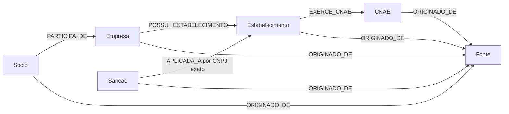

# FiscalGraph BR — Modelagem conceitual LPG

> **Status:** versão de trabalho consolidada para a Tarefa 3, baseada no contrato canônico de dados documentado pelo Dev 2.  
> **Escopo:** núcleo inicial do grafo para rastreabilidade societária, consulta cadastral e associação explicável de registros CEIS/CNEP.  
> **Integração:** antes do merge, conferir este documento com os CSVs versionados em `data/processed/canonical/` e com o schema Cypher da implementação.

---

## 1. Finalidade

O FiscalGraph BR utiliza um grafo de conhecimento para conectar informações públicas cadastrais de pessoas jurídicas a registros públicos de sanções administrativas, preservando a origem dos dados e os critérios utilizados para estabelecer cada ligação.

A modelagem separa a pessoa jurídica, identificada pela raiz do CNPJ, de seus estabelecimentos, identificados pelo CNPJ completo. Também representa os registros do Quadro de Sócios e Administradores (QSA), as atividades econômicas CNAE, os registros de compliance provenientes do CEIS e do CNEP e as fontes utilizadas na coleta.

O grafo deve permitir consultas explicáveis: para cada informação ou caminho apresentado, o sistema deve indicar os nós, os relacionamentos, os identificadores usados e as fontes que sustentam a conexão.

**Limite interpretativo:** vínculo societário, coincidência de nome ou presença em cadastro público não constitui, isoladamente, prova de fraude, sonegação, responsabilidade de terceiros ou irregularidade atual. O grafo organiza fatos publicados nas fontes e caminhos entre registros; não substitui análise jurídica ou investigação.

## 2. Escopo e base de dados

### 2.1. Arquivos canônicos

O modelo considera os sete arquivos CSV produzidos pelo pipeline do Dev 2:

| Arquivo | Conteúdo | Papel no grafo |
|---|---|---|
| `empresas.csv` | Dados cadastrais da pessoa jurídica pela raiz do CNPJ | Nós `Empresa` |
| `estabelecimentos.csv` | Matriz e filiais, identificadas pelo CNPJ completo | Nós `Estabelecimento` |
| `socios.csv` | Registros do QSA associados à raiz do CNPJ | Nós `Socio` e relações `PARTICIPA_DE` |
| `cnaes.csv` | Códigos e descrições de atividades econômicas | Nós `CNAE` |
| `estabelecimento_cnaes.csv` | Associação entre CNPJ do estabelecimento e código CNAE | Relações `EXERCE_CNAE` |
| `compliance.csv` | Registros de pessoa jurídica extraídos do CEIS e do CNEP | Nós `Sancao` e relações `APLICADA_A` |
| `fontes.csv` | Identificação, URL, competência e dados de coleta das bases | Nós `Fonte` |

`estabelecimento_cnaes.csv` representa uma associação entre entidades. Seus registros são convertidos em relacionamentos com propriedades, não em nós independentes.

### 2.2. Fontes documentadas

- **Receita Federal do Brasil (RFB):** dados cadastrais de empresas, estabelecimentos e QSA. A documentação do Dev 2 registra o uso dos dados abertos da RFB e de um espelho público para a consulta cadastral da amostra.
- **Controladoria-Geral da União (CGU) — CEIS:** Cadastro de Empresas Inidôneas e Suspensas.
- **Controladoria-Geral da União (CGU) — CNEP:** Cadastro Nacional de Empresas Punidas.
- **Instituto Brasileiro de Geografia e Estatística (IBGE/CONCLA):** códigos e descrições da CNAE.

Os identificadores internos `fonte_id` são preservados e usados para conectar os registros ao nó `Fonte`. URL, competência, data de coleta e arquivo de origem devem ser mantidos para auditoria da procedência.

### 2.3. Recorte da amostra

A documentação de fontes do Dev 2 informa uma amostra canônica de **16 empresas completas**, com estabelecimentos, sócios, CNAEs e registros de compliance associados. O script de construção descreve uma seleção inicial de 18 CNPJs — 10 presentes simultaneamente em CEIS e CNEP, 4 exclusivos do CEIS e 4 exclusivos do CNEP —, mas informa que registros sem retorno cadastral foram ignorados durante a coleta. Portanto, a quantidade efetivamente disponível nos CSVs canônicos prevalece sobre a quantidade inicialmente selecionada pelo script.

A documentação registra 50 registros de sanção ligados à amostra canônica: 38 provenientes do CEIS e 12 do CNEP. Também registra que, no recorte final, todos os registros de `compliance.csv` possuem correspondência cadastral pelo CNPJ completo. Esses números descrevem o recorte documentado e devem ser atualizados se os CSVs forem regenerados.

Registros de sanções aplicadas a pessoas físicas foram excluídos do conjunto canônico. Também foram excluídos CNPJs cuja consulta cadastral sofreu indisponibilidade transitória, para evitar registros empresariais incompletos no recorte.

---

## 3. Princípios de modelagem

1. **Granularidade empresarial:** `Empresa` representa a pessoa jurídica pela raiz do CNPJ; `Estabelecimento` representa cada unidade identificada pelo CNPJ completo.
2. **Identificadores como texto:** CNPJ básico, CNPJ completo e códigos que possam conter zeros à esquerda devem ser armazenados como strings.
3. **CNPJ alfanumérico:** aceitar oito caracteres alfanuméricos para o CNPJ básico e doze caracteres alfanuméricos seguidos de dois dígitos numéricos para o CNPJ completo. A validação estrutural não substitui a validação oficial dos dígitos verificadores.
4. **Identidade de sócios conservadora:** `socio_id` é uma chave técnica do registro de sócio no contexto da empresa; não é um identificador nacional da pessoa. Não deduplicar sócios por nome nem presumir identidade comum entre empresas.
5. **Associação de sanções por identificador:** criar `APLICADA_A` somente quando `cnpj_sancionado` corresponder exatamente a `Estabelecimento.cnpj`, após normalização formal. Não usar similaridade de nome ou razão social.
6. **Proveniência preservada:** manter `fonte_id`, `registro_origem`, competência, data de coleta, URL e arquivo de origem conforme disponíveis.
7. **Ausência não é evidência negativa:** a ausência de registro no recorte CEIS/CNEP não prova inexistência de sanções ou de qualquer outra irregularidade.
8. **Fato e inferência separados:** distinguir dados publicados pela fonte das conclusões obtidas ao percorrer múltiplos relacionamentos.
9. **Escopo temporal explícito:** os arquivos representam uma coleta/snapshot com competência indicada em `Fonte`. Não apresentar a amostra como histórico completo nem inferir vigência atual apenas pela ausência de `data_fim`.

## 4. Entidades (nós) e propriedades

Os nomes das propriedades seguem, sempre que possível, os campos dos CSVs canônicos, reduzindo ambiguidades entre ingestão, documentação e consultas.

### 4.1. `Empresa`

**Identificador:** `cnpj_basico` (oito caracteres). Representa a pessoa jurídica identificada pela raiz do CNPJ, independentemente da quantidade de estabelecimentos.

| Propriedade | Origem | Descrição |
|---|---|---|
| `cnpj_basico` | `empresas.csv` | Chave da pessoa jurídica |
| `razao_social` | `empresas.csv` | Razão social |
| `natureza_juridica` | `empresas.csv` | Natureza jurídica |
| `porte` | `empresas.csv` | Porte empresarial |
| `capital_social` | `empresas.csv` | Capital social declarado |

A procedência é representada por uma relação com `Fonte`. `fonte_id` e `registro_origem` do CSV são usados para construir essa relação e preservar a referência original; não precisam ser duplicados como atributos de negócio do nó.

### 4.2. `Estabelecimento`

**Identificador:** `cnpj` (14 caracteres no formato estrutural do CNPJ). Representa uma unidade da pessoa jurídica, como matriz ou filial.

| Propriedade | Origem | Descrição |
|---|---|---|
| `cnpj` | `estabelecimentos.csv` | Chave do estabelecimento |
| `cnpj_basico` | `estabelecimentos.csv` | Raiz da pessoa jurídica à qual pertence |
| `nome_fantasia` | `estabelecimentos.csv` | Nome fantasia, quando informado |
| `situacao_cadastral` | `estabelecimentos.csv` | Situação cadastral publicada |
| `data_inicio_atividade` | `estabelecimentos.csv` | Data de início da atividade |
| `uf` | `estabelecimentos.csv` | Unidade federativa |
| `municipio` | `estabelecimentos.csv` | Município conforme o dado canônico |

A relação com `Empresa` é estabelecida pela igualdade entre `Estabelecimento.cnpj_basico` e `Empresa.cnpj_basico`. Não presumir que `municipio` seja código IBGE: conservar o conteúdo e a semântica definidos pelo dataset.

### 4.3. `Socio`

**Identificador técnico:** `socio_id`. Representa um registro de sócio obtido do QSA para uma empresa específica. No contrato do Dev 2, `socio_id` é gerado com escopo limitado à empresa, considerando `cnpj_basico`, posição do registro e nome. Portanto, identifica a ocorrência canônica do sócio no recorte, e não uma pessoa de forma global.

| Propriedade | Origem | Descrição |
|---|---|---|
| `socio_id` | `socios.csv` | Identificador técnico do registro |
| `nome` | `socios.csv` | Nome publicado no QSA |
| `tipo_pessoa` | `socios.csv` | Tipo de pessoa informado |
| `qualificacao` | `socios.csv` | Qualificação do sócio no QSA |
| `data_entrada` | `socios.csv` | Data de entrada, quando disponível |

`cnpj_basico` do CSV é utilizado para estabelecer `PARTICIPA_DE`; `fonte_id` e `registro_origem` preservam a procedência. **Não armazenar CPF bruto.** Não fundir nós `Socio` apenas por coincidência de nome. Uma ligação de um mesmo sócio entre empresas diferentes só poderá ser introduzida mediante identificador estável, permitido e validado.

### 4.4. `CNAE`

**Identificador:** `codigo`. Representa uma atividade econômica da Classificação Nacional de Atividades Econômicas.

| Propriedade | Origem | Descrição |
|---|---|---|
| `codigo` | `cnaes.csv` | Código CNAE |
| `descricao` | `cnaes.csv` | Descrição da atividade |

A associação entre CNAE e estabelecimento é obtida de `estabelecimento_cnaes.csv`, e não apenas do catálogo `cnaes.csv`.

### 4.5. `Sancao`

**Identificador:** `registro_id`. Representa um registro de pessoa jurídica importado do CEIS ou do CNEP. O rótulo `Sancao` é uma simplificação conceitual para os registros desses cadastros; os dados devem continuar identificando a base de origem e a categoria/modalidade descrita pela fonte.

| Propriedade | Origem | Descrição |
|---|---|---|
| `registro_id` | `compliance.csv` | Identificador do registro canônico |
| `tipo_registro` | `compliance.csv` | Cadastro de origem: CEIS ou CNEP |
| `orgao_responsavel` | `compliance.csv` | Órgão sancionador/responsável informado |
| `numero_processo` | `compliance.csv` | Número do processo, quando disponível |
| `data_inicio` | `compliance.csv` | Data de início registrada |
| `data_fim` | `compliance.csv` | Data final, quando informada |
| `situacao` | `compliance.csv` | Abrangência da sanção conforme a fonte |
| `descricao` | `compliance.csv` | Categoria/modalidade da sanção |
| `observacoes` | `compliance.csv` | Observações publicadas |
| `fundamentacao_legal` | `compliance.csv` | Fundamentação legal informada |
| `cnpj_sancionado` | `compliance.csv` | CNPJ da pessoa jurídica indicada no registro |
| `url_fonte` | `compliance.csv` | URL pública do conjunto de dados |

`fonte_id` e `registro_origem` também devem ser preservados por meio da relação com `Fonte` e dos metadados de procedência. `data_fim` vazio não confirma, isoladamente, que a sanção está vigente na data da consulta. A situação temporal deve ser apresentada com as informações e limitações fornecidas pela fonte.

### 4.6. `Fonte`

**Identificador:** `fonte_id`. Representa uma base ou conjunto de dados utilizado na construção do grafo.

| Propriedade | Origem | Descrição |
|---|---|---|
| `fonte_id` | `fontes.csv` | Identificador interno da fonte |
| `nome` | `fontes.csv` | Nome do conjunto de dados |
| `orgao_responsavel` | `fontes.csv` | Órgão responsável |
| `url` | `fontes.csv` | URL de consulta ou obtenção |
| `data_coleta` | `fontes.csv` | Data e hora da coleta |
| `competencia` | `fontes.csv` | Competência ou referência temporal |
| `arquivo_origem` | `fontes.csv` | Arquivo utilizado na ingestão |

A entidade permite rastrear a procedência de empresas, estabelecimentos, sócios, CNAEs e sanções, bem como a competência e o momento da coleta.

---

## 5. Relacionamentos

| Origem | Relacionamento | Destino | Fonte de construção | Regra |
|---|---|---|---|---|
| `Socio` | `PARTICIPA_DE` | `Empresa` | `socios.csv` | `Socio` pertence ao registro de QSA cujo `cnpj_basico` corresponde ao da empresa |
| `Empresa` | `POSSUI_ESTABELECIMENTO` | `Estabelecimento` | `estabelecimentos.csv` | `Empresa.cnpj_basico` = `Estabelecimento.cnpj_basico` |
| `Estabelecimento` | `EXERCE_CNAE` | `CNAE` | `estabelecimento_cnaes.csv` | Correspondência conjunta de `cnpj` e `codigo` |
| `Sancao` | `APLICADA_A` | `Estabelecimento` | `compliance.csv` | `Sancao.cnpj_sancionado` = `Estabelecimento.cnpj` |
| `Empresa` | `ORIGINADO_DE` | `Fonte` | `empresas.csv` | Correspondência de `fonte_id` |
| `Estabelecimento` | `ORIGINADO_DE` | `Fonte` | `estabelecimentos.csv` | Correspondência de `fonte_id` |
| `Socio` | `ORIGINADO_DE` | `Fonte` | `socios.csv` | Correspondência de `fonte_id` |
| `CNAE` | `ORIGINADO_DE` | `Fonte` | `cnaes.csv` | Correspondência de `fonte_id` |
| `Sancao` | `ORIGINADO_DE` | `Fonte` | `compliance.csv` | Correspondência de `fonte_id` |

### 5.1. Propriedades dos relacionamentos

- **`PARTICIPA_DE`:** preservar `qualificacao`, `data_entrada` e, quando necessário para auditoria, `registro_origem`. Representa o que está registrado no QSA na competência coletada; não comprova, por si só, controle societário atual.
- **`POSSUI_ESTABELECIMENTO`:** pode preservar `registro_origem` e a referência da fonte do registro cadastral que sustenta a associação.
- **`EXERCE_CNAE`:** preservar `principal` (booleano ou representação equivalente do CSV), `registro_origem` e a referência da fonte. `principal` distingue a atividade principal das secundárias.
- **`APLICADA_A`:** preservar a referência ao registro de origem e o identificador utilizado na associação. A regra de criação é a igualdade exata do CNPJ completo após normalização formal; não utilizar similaridade textual.
- **`ORIGINADO_DE`:** preservar, quando necessário, o identificador do registro original (`registro_origem`). `Fonte` fornece URL, órgão, competência, data de coleta e arquivo de origem.

A implementação pode armazenar `fonte_id` como propriedade auxiliar da relação, mas a ligação com o nó `Fonte` deve continuar sendo a representação explícita da proveniência no grafo.

### 5.2. Cardinalidades conceituais

| Relacionamento | Cardinalidade esperada |
|---|---|
| `Empresa` — `POSSUI_ESTABELECIMENTO` — `Estabelecimento` | Uma empresa pode possuir um ou vários estabelecimentos; cada estabelecimento pertence a uma raiz de CNPJ |
| `Socio` — `PARTICIPA_DE` — `Empresa` | Uma empresa pode ter vários registros de sócios; cada ocorrência de `Socio` do CSV está associada à empresa indicada no registro |
| `Estabelecimento` — `EXERCE_CNAE` — `CNAE` | Um estabelecimento pode estar associado a várias atividades; um CNAE pode estar associado a vários estabelecimentos |
| `Sancao` — `APLICADA_A` — `Estabelecimento` | Cada registro canônico de sanção aponta para o estabelecimento identificado pelo CNPJ informado |
| Entidade — `ORIGINADO_DE` — `Fonte` | Uma fonte pode originar muitos registros; cada registro canônico possui a fonte indicada em seu `fonte_id` |

A cardinalidade geral de participação societária pode ser N:N no domínio, mas a amostra atual não permite identificar globalmente a mesma pessoa entre empresas. A modelagem não deve criar essa conexão apenas por nome.

---

## 6. Regras de identidade, normalização e associação

### 6.1. CNPJ

- `cnpj_basico`: oito caracteres, armazenados como string.
- `cnpj`: quatorze caracteres, armazenados como string.
- CNPJ completo: doze caracteres alfanuméricos seguidos de dois dígitos numéricos.
- Remover pontuação e espaços externos para comparação, preservando letras em caixa alta.
- Não remover zeros à esquerda.
- A checagem de formato não substitui a validação oficial dos dígitos verificadores.

### 6.2. Associação entre sanção e estabelecimento

O vínculo é criado exclusivamente quando:

```text
compliance.csv.cnpj_sancionado
    ==
estabelecimentos.csv.cnpj
```

A associação deve ocorrer após a normalização formal do CNPJ. No recorte documentado pelo Dev 2, todos os registros canônicos de compliance possuem correspondência cadastral. Se uma futura carga apresentar registro sem correspondência, ele deve permanecer sem ligação ou ser encaminhado para análise; não deve ser associado por nome.

A empresa correspondente pode ser alcançada pelo caminho:

```text
(Sancao)-[:APLICADA_A]->(Estabelecimento)
(Estabelecimento)<-[:POSSUI_ESTABELECIMENTO]-(Empresa)
```

Esse caminho não equivale a uma sanção aplicada automaticamente a todos os estabelecimentos da raiz, nem autoriza inferir responsabilidade de sócios ou de outras empresas relacionadas.

### 6.3. Identidade dos sócios

- Não armazenar CPF bruto.
- Não deduplicar registros por nome.
- Tratar `socio_id` como chave técnica de ocorrência, com escopo limitado à empresa conforme o algoritmo do Dev 2.
- Não afirmar que dois registros de mesmo nome em empresas diferentes representam a mesma pessoa.
- Não criar relacionamentos societários indiretos ou compartilhados sem identificador estável, permitido e validado.

### 6.4. Dados ausentes e temporalidade

- Campos vazios permanecem ausentes; não devem ser substituídos por valores inferidos.
- A ausência de `data_fim` não comprova vigência atual.
- A ausência de uma empresa ou sanção no recorte não comprova inexistência do registro em toda a base pública.
- A competência e a data de coleta devem ser consultadas em `Fonte`.
- O modelo inicial representa o snapshot coletado. Histórico de alterações cadastrais ou societárias exige snapshots sucessivos e estratégia de versionamento, não contemplados automaticamente pelos CSVs atuais.

## 7. Consultas que o modelo deve suportar

1. **Perfil empresarial:** recuperar uma empresa por `cnpj_basico` e listar estabelecimentos, situação cadastral, localização e CNAEs.
2. **Quadro societário:** listar os registros de sócios associados a uma empresa, com qualificação, data de entrada quando disponível e fonte.
3. **Registros de compliance:** identificar registros CEIS/CNEP associados a um estabelecimento por correspondência exata do CNPJ, apresentando categoria, órgão, datas, processo e fonte.
4. **Caminho societário explicável:** verificar se uma empresa consultada está conectada, por meio de registros de sócios cuja identidade seja efetivamente confirmada, a outra empresa associada a registro CEIS/CNEP. Com o identificador de sócio atualmente descrito pelo Dev 2, essa consulta entre empresas não deve ser habilitada por simples igualdade de nome.
5. **Proveniência:** recuperar fonte, URL, competência, data de coleta, arquivo e registro de origem que sustentam um nó ou relacionamento.
6. **Atividades econômicas:** listar CNAEs principais e secundários de cada estabelecimento, preservando o indicador `principal`.

Toda consulta que apresente um caminho de múltiplos saltos deve exibir os nós e relacionamentos intermediários, além dos identificadores e fontes que justificam cada ligação.

## 8. Constraints e índices

As restrições de unicidade devem refletir as chaves do contrato canônico:

| Label / relação | Chave candidata |
|---|---|
| `Empresa` | `cnpj_basico` |
| `Estabelecimento` | `cnpj` |
| `Socio` | `socio_id` |
| `CNAE` | `codigo` |
| `Sancao` | `registro_id` |
| `Fonte` | `fonte_id` |

Para `EXERCE_CNAE`, a combinação `cnpj` + `codigo` é a chave composta do arquivo de associação; a implementação deve evitar duplicar a mesma relação para o mesmo par de nós.

Índices adicionais devem ser criados apenas quando houver consultas que os justifiquem. Candidatos para avaliação:

- `Estabelecimento.situacao_cadastral`, `uf` e `municipio`;
- `Empresa.porte`;
- `Sancao.tipo_registro`, `numero_processo` e `situacao`;
- índices full-text para `Empresa.razao_social`, `Socio.nome` e campos textuais de `Sancao`, caso a busca textual seja necessária.

A busca textual por nome deve servir à descoberta de candidatos, nunca como critério suficiente para estabelecer identidade ou criar relacionamentos.

Não há, no contrato canônico atual, campos `embedding` ou `modeloEmbedding`. Portanto, índice vetorial e recuperação semântica por embeddings não fazem parte do núcleo desta modelagem. Poderão ser adicionados quando houver corpus textual, processo de geração de embeddings e modelo/dimensão definidos.

As constraints e sintaxes devem ser conferidas na versão e edição do Neo4j utilizadas pelo grupo.

## 9. Entidades e funcionalidades fora do núcleo inicial

As entidades abaixo apareciam em rascunhos anteriores, mas não são sustentadas diretamente pelos sete CSVs canônicos atuais. Por isso, não integram o modelo inicial:

| Entidade/funcionalidade | Motivo para não integrar o núcleo atual | Condição para inclusão futura |
|---|---|---|
| `Documento` | Os CSVs preservam URLs, arquivos e referências de origem, mas não constituem corpus documental modelado como nós independentes | Ingestão e catalogação efetiva de documentos, com identificadores e metadados próprios |
| `Trecho` | Não há tabela canônica de trechos extraídos nem embeddings no contrato atual | Extração de trechos, vínculo com documentos/registros e definição do modelo de embeddings |
| `RegimeTributario` | Não há dataset canônico específico de regime tributário nesta amostra; `porte` não equivale a regime | Fonte oficial específica e campos que comprovem opção, enquadramento e períodos |
| `RegraTributaria` | Não há corpus normativo selecionado e estruturado nesta entrega | Seleção de normas oficiais, extração de regras, vigência e validação documental/jurídica |
| Identidade global de sócios | `socio_id` possui escopo por empresa e não identifica a mesma pessoa entre empresas | Identificador estável, legalmente utilizável e processo de resolução validado |

Esses itens podem ser apresentados como possibilidades de evolução, sem afirmar que já foram coletados, implementados ou validados.

## 10. Limitações e cuidados de interpretação

1. **Cobertura da amostra:** os resultados representam o recorte canônico documentado, não a totalidade das empresas brasileiras nem a totalidade dos registros CEIS/CNEP.
2. **Temporalidade:** os dados refletem a competência e o momento de coleta registrados em `Fonte`. Alterações posteriores podem não estar representadas.
3. **Identidade societária:** a chave técnica atual de sócios não permite deduplicação confiável entre empresas distintas.
4. **Correspondência de compliance:** o vínculo depende da disponibilidade e compatibilidade do CNPJ completo. Registros sem identificador confiável não devem ser associados.
5. **Interpretação de sanções:** os campos do cadastro devem ser exibidos com sua terminologia de origem. Não concluir automaticamente que uma sanção está vigente, que representa fraude ou que alcança sócios, empresas relacionadas ou todos os estabelecimentos.
6. **Dados cadastrais:** situação cadastral, porte, natureza jurídica e CNAE descrevem informações cadastrais; isoladamente, não demonstram regularidade ou irregularidade fiscal.
7. **Ausência de registro:** não encontrar uma empresa no recorte consultado não prova que ela não possua registros em outras bases ou competências.

## 11. Alinhamento com a implementação

Antes da integração, conferir:

- se os cabeçalhos e tipos dos sete CSVs em `data/processed/canonical/` correspondem às propriedades descritas;
- se as chaves únicas são aplicadas conforme a seção 8;
- se a ingestão preserva zeros à esquerda e o formato alfanumérico do CNPJ;
- se `PARTICIPA_DE`, `POSSUI_ESTABELECIMENTO`, `EXERCE_CNAE` e `APLICADA_A` obedecem às regras de associação deste documento;
- se `ORIGINADO_DE` preserva a procedência de cada registro;
- se o diagrama conceitual e o schema Cypher representam o mesmo conjunto de entidades, relações e propriedades;
- se a quantidade de registros carregados corresponde à versão efetiva dos CSVs, sem assumir que a seleção inicial de 18 CNPJs foi integralmente carregada.

O validador estrutural do Dev 2 verifica cabeçalhos, chaves e formatos básicos, mas a documentação ressalta que a qualidade semântica deve ser revisada manualmente. A validação estrutural não substitui a conferência das correspondências e da interpretação dos dados.

## 12. Referências e documentação de apoio

- Receita Federal do Brasil — Dados abertos: <https://www.gov.br/receitafederal/dados>
- Receita Federal do Brasil — Layout e metadados do CNPJ: <https://www.gov.br/receitafederal/dados/cnpj-metadados.pdf>
- Receita Federal do Brasil — CNPJ alfanumérico: <https://www.gov.br/receitafederal/pt-br/acesso-a-informacao/acoes-e-programas/programas-e-atividades/cnpj-alfanumerico/cnpj-alfa>
- Portal da Transparência — Download CEIS: <https://portaldatransparencia.gov.br/download-de-dados/ceis>
- Portal da Transparência — Dicionário CEIS: <https://portaldatransparencia.gov.br/dicionario-de-dados/ceis>
- Portal da Transparência — Download CNEP: <https://portaldatransparencia.gov.br/download-de-dados/cnep>
- Portal da Transparência — Dicionário CNEP: <https://portaldatransparencia.gov.br/dicionario-de-dados/cnep>
- IBGE/CONCLA — Classificação Nacional de Atividades Econômicas: <https://concla.ibge.gov.br/>
- Neo4j — Constraints: <https://neo4j.com/docs/cypher-manual/current/schema/constraints/>
- Neo4j — Full-text indexes: <https://neo4j.com/docs/cypher-manual/current/indexes/semantic-indexes/full-text-indexes/>

**Documentos internos que fundamentam esta modelagem:**
- `docs/fontes-datasets.md`
- `docs/dicionario-dados.md`
- `scripts/build_canonical_dataset.py`
- `scripts/validate_canonical_data.py`
- CSVs em `data/processed/canonical/`

## 13. Diagrama lógico em Mermaid (referência textual)

O diagrama visual da entrega deve representar o núcleo inicial abaixo. A sintaxe pode ser reutilizada como base para o arquivo em `diagrams/`.



O diagrama é uma representação resumida. As propriedades dos nós, regras de associação, cardinalidades e limitações estão definidas nas seções anteriores.
