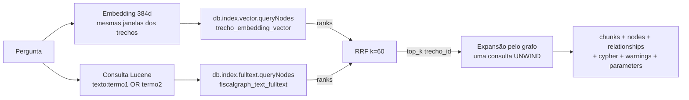

# Recuperação híbrida, embeddings e multi-hop — dev5

Camada de recuperação do FiscalGraph BR: busca vetorial e full-text sobre nós `Trecho` no Neo4j,
fusão por Reciprocal Rank Fusion (RRF), expansão pelo grafo e caminho mínimo entre empresas.
A geração da resposta em linguagem natural fica com o dev1 e a interface com o dev6; este serviço
devolve **evidências** em uma estrutura estável. Este documento é a referência oficial do contrato do
dev5 (seção 7).

> O `rrf_score` mede relevância de recuperação. **Não é** probabilidade de irregularidade, fraude ou
> culpa. Caminhos no grafo e menções textuais não provam vínculo jurídico nem responsabilidade.

## 1. Resumo das decisões

| Item | Valor |
| --- | --- |
| Modelo de embeddings | `sentence-transformers/paraphrase-multilingual-MiniLM-L12-v2` (local, sem chave de API) |
| Dimensão / similaridade | 384 / `cosine`, vetores L2-normalizados |
| Representação do texto | **texto inteiro**: janelas de 126 tokens + 2 especiais (128 posições), sobreposição de 32, média ponderada pelos tokens novos de cada janela e normalização L2 (seção 4) |
| Versão da estratégia | `v2-janelas-126-sobreposicao-32-media-ponderada-tokens-novos-l2`, gravada em `Trecho.embedding_pipeline_version` |
| Cobertura | 54/54 trechos representados integralmente; 150 janelas; 0 tokens não representados |
| Índice vetorial | `trecho_embedding_vector` em `Trecho.embedding` — criado pelo dev5 (`cypher/04_indice_vetorial_trecho.cypher`) |
| Índice full-text | `fiscalgraph_text_fulltext` — índice integrado de dev3, consultado só no campo `texto` e filtrado para `:Trecho` |
| Fusão | RRF, `score = Σ 1/(k + rank)`, `k = 60` |
| `top_k` / candidatos | padrão 5, máximo 20 / `max(4 × top_k, 20)` por busca antes da fusão |
| Expansão | `Trecho → Fonte`, `Trecho → Sancao → Estabelecimento ← Empresa ← Socio`, `Trecho → MENCIONA → Estabelecimento` |
| Multi-hop | `shortestPath` em Cypher puro (sem GDS), até 6 relacionamentos; também como serviço `company_paths` |
| Caminho societário real | **inexistente no recorte** (0 de 153 pares); só há caminhos estruturais por CNAE (seção 8.1) |

## 2. Alinhamento com o schema integrado

O pacote do dev5 foi escrito antes da integração de dev3/dev4 e usava nomes que não existem no banco.
Seguindo a regra "não codificar nomes diferentes do schema integrado", o código usa os nomes da `main`:

| Pacote / contrato original | Schema integrado (adotado) | Observação |
| --- | --- | --- |
| índice full-text `trecho_text_fulltext` | `fiscalgraph_text_fulltext` | Índice compartilhado (`Empresa\|Socio\|Sancao\|Trecho`). A consulta usa `texto:(...)` e `WHERE node:Trecho`. |
| índice vetorial `trecho_embedding_vector` | **não existia** | `docs/validacao-neo4j.md` atribui índice vetorial e embeddings ao dev5. Nome do pacote mantido; criado por `cypher/04_indice_vetorial_trecho.cypher`. |
| rótulo `RegistroCompliance` | `Sancao` | O campo `registro_id` do contrato continua igual. |
| `RegistroCompliance -[:REFERE_SE_A]-> Empresa` | `Sancao -[:APLICADA_A]-> Estabelecimento <-[:POSSUI_ESTABELECIMENTO]- Empresa` | Ligação por CNPJ completo exato (dev3). |
| documento de modelo do grafo citado no pacote | `docs/modelagem-lpg.md` | O nome citado no pacote não existe na `main`; usado o documento de modelagem integrado. |

A especificação de contrato do coordenador veio originalmente no pacote do dev5 e hoje encontra-se consolidada em `docs/CONTRATO_INTEGRACAO_FINAL.md`; as partes que valem para o dev5 permanecem reproduzidas na seção 7.2.

Os testes `SchemaAlignmentTests` (`tests/test_retrieval.py`) leem `cypher/01_schema_fiscalgraph.cypher` e
`cypher/04_indice_vetorial_trecho.cypher` e falham se os nomes no código divergirem dos arquivos versionados.
O índice vetorial (`cypher/04_indice_vetorial_trecho.cypher`) já integra o pipeline oficial pós-PR #9 via `scripts/generate_embeddings.py`.

## 3. Arquitetura



| Arquivo | Função |
| --- | --- |
| `app/services/embeddings.py` | Modelo, dimensão, índice e estratégia de janelas (`SentenceEncoder`), usados igualmente para trechos e perguntas; versão da estratégia. |
| `app/services/ranking.py` | `reciprocal_rank_fusion(vector_ids, fulltext_ids, k=60)`. |
| `app/services/retrieval.py` | `retrieve_context(question, top_k=5)`, `company_paths(cnpj_a, cnpj_b)`, classe `GraphHybridRetriever` e CLI de consulta manual. |
| `app/services/multi_hop.py` | `find_company_paths`: caminho mínimo societário e estrutural entre duas empresas, no formato de nós/arestas do contrato. |
| `app/services/contract.py` | Validadores executáveis (`validate_retrieval_response`, `validate_company_paths_response`) e `example_final_response`. |
| `scripts/generate_embeddings.py` | Cria/confere o índice, detecta embeddings de versão antiga, grava `embedding`, `embedding_model`, `embedding_pipeline_version` e `embedding_windows`, e verifica o resultado no banco. |
| `scripts/audit_embedding_truncation.py` | Auditoria sem Neo4j: origem do limite, tokens por campo, janelas e tokens não representados. |
| `scripts/evaluate_embedding_strategies.py` | Comparação das estratégias de embedding (sem Neo4j) e avaliação do sistema híbrido real (`--hibrido`). |
| `scripts/export_contract_examples.py` | Gera os exemplos JSON reais do contrato e o exemplo demonstrativo da resposta do dev1. |
| `cypher/04_indice_vetorial_trecho.cypher` | DDL e conferência do índice vetorial e dos vetores gravados. |
| `cypher/03_multi_hop.cypher` | Consultas de caminho mínimo (reais, diagnóstico e cenário sintético). |
| `tests/test_ranking.py`, `tests/test_retrieval.py` | Testes unitários (sem Neo4j e sem modelo). |
| `tests/test_multi_hop_sintetico.py`, `tests/test_retrieval_integracao.py` | Testes de integração com o Neo4j e o modelo (skip se indisponíveis). |
| `docs/exemplos/resposta_final_dev1.exemplo.json` | Exemplo **demonstrativo** da resposta final do dev1, para o dev6 testar a interface. |
| `requirements-dev5.txt` | `sentence-transformers>=3.0` (seção 9). |

## 4. Embeddings

### 4.1. O problema: o modelo lê no máximo 128 tokens

- O limite é configuração do modelo: `"max_seq_length": 128` no `sentence_bert_config.json`. O
  sentence-transformers corta o texto nesse tamanho antes de gerar o vetor, **sem aviso**.
- A arquitetura (BERT de 12 camadas, `config.json`) aceita até 512 posições (`max_position_embeddings`).
  Verificado: com 128, 256 e 512 o modelo gera vetores finitos e normalizados; com 600 ele falha
  (`tensor a (600) must match … (512)`). Duas posições são tokens especiais (início e fim).
- Token é pedaço de palavra (vocabulário de 250.037 pedaços). Nos trechos, a mediana é de 94 palavras e
  2,18 tokens por palavra; caixa alta rende mais pedaços (`administração` = 1, `ADMINISTRAÇÃO` = 2).
- O dev4 monta cada trecho com `descricao` + `observacoes` + `fundamentacao_legal`. A fundamentação é a
  transcrição da lei, em caixa alta: mediana de 198 tokens, máximo de 691, e sozinha passa do limite em
  35 dos 54 registros.

Com a estratégia anterior (truncamento em 128), **40 dos 54 trechos perdiam o final: 7.557 tokens não
eram representados** no vetor. Exemplo: em `CEIS-132342` (209 tokens), a parte a partir de
"A REABILITAÇÃO PERANTE A PRÓPRIA AUTORIDADE…" (81 tokens) era ignorada.

### 4.2. Estratégia adotada: janelas de tokens com sobreposição

1. O texto inteiro é tokenizado com o tokenizador do próprio modelo (sem tokens especiais e sem corte).
2. Os tokens são divididos em janelas de **126 tokens** (+ início e fim = 128 posições) que avançam
   94 tokens, ou seja, com **32 de sobreposição**. A última janela é alinhada ao fim do texto, para ter
   contexto completo e incluir o último token.
3. Cada janela passa pelo modelo e vira um vetor normalizado.
4. Os vetores das janelas são combinados por **média ponderada pela quantidade de tokens que cada janela
   acrescenta** (a sobreposição não conta duas vezes) e o resultado é normalizado em L2.

Resultado: **um único vetor de 384 dimensões por `Trecho`**, finito, de norma 1, compatível com o índice
existente. Não há nó novo nem mudança de schema; `Trecho.texto` não é alterado (54/54 textos do banco
idênticos a `trechos.jsonl` após a regeneração) e o full-text continua sobre o texto completo.

| Medida | Estratégia anterior | Estratégia atual |
| --- | --- | --- |
| Trechos com conteúdo não representado | 40 de 54 | **0 de 54** |
| Tokens não representados | 7.557 | **0** |
| Janelas | 54 (1 por trecho) | 150 (14 trechos com 1 janela; 40 com mais de uma; máximo 8) |
| Exemplo `CEIS-132342` | lê até "…SEJA PROMOVIDA" | janela 1 `[0, 126)` e janela 2 `[81, 207)`, que termina em "…INCISO ANTERIOR.", o fim real do texto |

Perguntas e trechos passam pelo **mesmo** `SentenceEncoder.encode`. Uma pergunta que cabe em uma janela
produz o mesmo vetor que `SentenceTransformer.encode` (cosseno ≥ 0,99999996, verificado nos dois
ambientes). A inferência por janela monta a entrada `início + tokens + fim` a partir dos tokens especiais
detectados no próprio tokenizador; `build_inputs_with_special_tokens` não serve porque, neste modelo,
não insere os especiais (transformers 4) ou nem existe (transformers 5).

### 4.3. Por que janelas de 128 e não 512: avaliação

Não há perguntas rotuladas no projeto, então a escolha foi feita com uma avaliação autossupervisionada
e explícita (`scripts/evaluate_embedding_strategies.py`):

- **consultas "final"**: as últimas 30 palavras de cada um dos 40 trechos longos, tiradas só da parte
  que o truncamento ignorava;
- **consultas "início"**: as primeiras 30 palavras de cada um dos 54 trechos (regressão);
- **relevante** = todo trecho que contém a consulta literalmente (textos legais se repetem).

Busca vetorial pura (cosseno exato entre os 54 vetores), MRR do primeiro relevante:

| Estratégia | Tokens não repr. | Final: acerto@1 / MRR | Início: acerto@1 / MRR |
| --- | --- | --- | --- |
| truncado em 128 (anterior) | 7.557 | 0,00 / 0,24 | 0,65 / **0,80** |
| passada única com 512 | 629 | 0,50 / 0,54 | 0,37 / 0,43 |
| **janelas de 128, média ponderada (adotada)** | **0** | **0,53 / 0,63** | **0,41 / 0,53** |
| janelas de 128, média simples | 0 | 0,57 / 0,69 | 0,39 / 0,48 |
| janelas de 256 | 0 | 0,50 / 0,55 | 0,39 / 0,45 |
| janelas de 512 | 0 | 0,50 / 0,54 | 0,37 / 0,43 |

Conclusões:

- Aumentar o limite para 512 **não** melhora: representa mais texto, mas é pior que janelas de 128 nas
  duas medidas. É coerente com o modelo ter sido preparado para 128 tokens.
- Entre as estratégias de cobertura total, janelas de 128 são as melhores. A média ponderada fica entre a
  média simples (melhor no final, pior no início) e é a agregação pedida.
- Não foram criados pesos especiais para o início do texto: ajustá-los nos mesmos 54 trechos, sem
  conjunto de validação, seria sobreajuste.

### 4.4. Efeito no sistema híbrido real

Mesmas consultas, agora pelo `retrieve_context` completo (vetorial + full-text + RRF, `top_k = 20`),
medidas no Neo4j com os vetores antigos e depois com os novos:

| Consultas | MRR antes | MRR depois | Acerto@1 antes → depois | Acerto@5 antes → depois |
| --- | --- | --- | --- | --- |
| final do texto (40) | 0,64 | **0,88** | 0,47 → **0,82** | 0,85 → **0,97** |
| início do texto (54) | **0,94** | 0,83 | **0,93** → 0,76 | **0,94** → 0,91 |
| total ponderado (94) | 0,81 | **0,85** | | |

O ganho no conteúdo que antes era invisível ao vetor é grande; há uma **perda nas consultas sobre o
início** dos trechos longos. Investigação dos 13 casos de início que saíram do 1º lugar:

- em 10, o trecho certo continua **em 1º no full-text**; um trecho que aparece bem nas duas listas
  (ex.: vetorial 1º + full-text 2º) passa à frente pelo RRF, porque o vetor agora representa o texto
  inteiro e não favorece mais o começo;
- em 3 (`CEIS-335447`, `CEIS-335448`, `CEIS-335450`), o trecho saiu do top 20: textos legais longos e
  genéricos, que compartilham as 10 primeiras palavras com `CEIS-283427` e só eram achados porque o
  vetor antigo conhecia apenas o começo.

Essa troca é a consequência esperada de representar o texto inteiro num único vetor e está registrada
como limitação (seção 11). Saída completa em `docs/evidencias/dev5_avaliacao_estrategias_embeddings.txt`.

### 4.5. Gerador, versionamento e verificação

`scripts/generate_embeddings.py`:

- processa os trechos **sem embedding**, com **outro modelo** ou com **versão de estratégia diferente**
  (`embedding_pipeline_version` ausente ou diferente da atual); `--force` reprocessa todos e `--dry-run`
  mostra quantos estão pendentes por motivo. O nome do modelo não é usado para representar a versão;
- antes de gravar, cria o índice com `IF NOT EXISTS` e confere tipo, rótulo, propriedade, dimensão e
  similaridade; se o índice existir com outra configuração, **para sem gravar**;
- recusa vetores com dimensão errada, NaN ou infinito, e para se a segmentação deixar tokens de fora;
- grava `embedding`, `embedding_model`, `embedding_pipeline_version` e `embedding_windows`;
- ao final espera o índice ficar `ONLINE` e confere no banco cobertura, dimensão, norma (|1 − norma| ≤ 0,001)
  e se todos os `Trecho` estão na versão atual; qualquer divergência encerra com erro.

O serviço confere, uma vez por instância de `GraphHybridRetriever`, se os vetores gravados são da mesma
versão usada para codificar a pergunta e avisa em `warnings` quando não são. Vetores gerados em Python 3.9
(sentence-transformers 5.1.2) e em Python 3.13 (sentence-transformers 6.2.0) são equivalentes (cosseno
mínimo 1,0000000).

Trocar modelo ou dimensão continua exigindo ajuste coordenado com dev3 (recriar o índice). Trocar só a
segmentação muda a versão da estratégia; basta rodar o gerador.

## 5. Busca full-text

A pergunta vira uma consulta Lucene `texto:(termo1 OR termo2 ...)`:

- stopwords e palavras de pergunta em português são removidas (o analisador do índice,
  `standard-no-stop-words`, não as remove, e com OR elas trariam quase todos os trechos);
- números com separador geram duas formas: a contínua e uma frase com a pontuação original.
  Ex.: `Lei 12.846` → `12846 OR "12.846"`; `01.340.937/0001-79` → `01340937000179 OR "01.340.937/0001-79"`.
  O analisador mantém `01.340.937` como um token e quebra em `/` e `-`, então só a frase encontra o
  CNPJ formatado;
- os termos só contêm letras, dígitos e `_` (frases: dígitos e `.-/`), em minúsculas: operadores
  Lucene digitados pelo usuário (`AND`, `:`, `*`, `~`, parênteses) não chegam ao índice;
- OR em vez de AND: com AND, uma pergunta em linguagem natural quase nunca tem todos os termos no mesmo trecho.

## 6. Fusão por RRF

`rrf_score(d) = 1/(60 + vector_rank) + 1/(60 + fulltext_rank)`, com a parcela omitida quando o trecho não
aparece numa das listas. Só a posição entra no cálculo: o score de cosseno e o score Lucene, que estão em
escalas diferentes, **nunca são somados**. Eles aparecem nos campos informativos `vector_score` e
`fulltext_score` para auditoria.

O maior valor possível é `2/61 ≈ 0,0328` (1º lugar nas duas buscas), devolvido em
`parameters.rrf_max_score`. Um trecho em 1º lugar em só uma das buscas recebe metade disso.

Regras implementadas e testadas: rank 1-based; `None` ignorado; identificador repetido numa lista conta
só a primeira vez; empates mantêm a ordem de primeira aparição (vetorial primeiro); `k` inteiro ≥ 1.
Os chunks saem sempre em ordem decrescente de `rrf_score`; nenhum outro critério reordena o resultado.

## 7. Contrato do dev5

### 7.1. `retrieve_context(question, top_k=5)`

```python
from app.services.retrieval import GraphHybridRetriever, retrieve_context
from app.services.contract import validate_retrieval_response

contexto = retrieve_context("Quais empresas foram declaradas inidôneas?", top_k=5)
assert validate_retrieval_response(contexto) == []

# Com driver controlado pelo consumidor (Streamlit, testes):
retriever = GraphHybridRetriever(driver, database="neo4j")
contexto = retriever.retrieve_context("...", top_k=5)
```

`retrieve_context` lê o `.env`, cria o driver e mantém o modelo carregado entre chamadas.

Campos de primeiro nível (todos obrigatórios):

| Campo | Tipo | Conteúdo |
| --- | --- | --- |
| `query` | `str` | pergunta recebida |
| `retrieval_mode` | `str` | sempre `"hybrid"` (compatibilidade); o que de fato contribuiu está em `parameters.active_searches` |
| `chunks` | `list[dict]` | trechos recuperados, em ordem decrescente de `rrf_score` |
| `nodes` | `list[dict]` | `{"id": "Rotulo:chave", "label": str, "properties": dict}` |
| `relationships` | `list[dict]` | `{"source": id, "target": id, "type": str, "properties": dict}`, com a direção original |
| `cypher` | `str` | as três consultas executadas (vetorial, full-text, expansão) |
| `warnings` | `list[str]` | avisos claros; lista vazia quando não há ressalva |
| `parameters` | `dict` | parâmetros e estado da execução (abaixo) |

Campos de cada item de `chunks`:

| Campo | Tipo | Conteúdo |
| --- | --- | --- |
| `trecho_id`, `texto` | `str` | identificador e texto integral do trecho |
| `registro_id`, `fonte_id`, `url_fonte` | `str \| None` | procedência (do `Trecho`; se vazia, da `Sancao`/`Fonte` ligadas) |
| `vector_rank`, `fulltext_rank` | `int \| None` | posição em cada busca; `None` quando o trecho não veio daquela busca |
| `rrf_score` | `float` | `Σ 1/(60 + rank)`; conferido pelo validador a partir dos ranks |
| `vector_score`, `fulltext_score` | `float \| None` | scores brutos, só informativos (escalas diferentes); `None` junto com o rank |
| `graph_paths` | `list[str]` | caminhos do trecho no grafo em notação Cypher legível |
| `identifier_matches` | `list[str]` | CNPJs citados na pergunta que aparecem literalmente no texto do trecho |

Campos de `parameters`: `top_k`, `candidate_k`, `rrf_k`, `rrf_max_score`, `active_searches`
(`["vector", "fulltext"]`, só uma delas ou `[]`), `search_status` (`vector`/`fulltext` →
`com_resultados`, `sem_resultados`, `indisponivel` ou `nao_executada`), `embedding_model`,
`embedding_dimensions`, `embedding_pipeline_version`, `vector_index`, `fulltext_index`, `fulltext_query`
e `query_identifiers` (CNPJs detectados na pergunta, pela mesma regra estrutural do dev4).

Nós: cada rótulo tem uma lista fixa de propriedades mínimas para evidência. `embedding`, `texto`,
`mencoes_json`, `observacoes`, `fundamentacao_legal` e `capital_social` não saem em `nodes` (o texto do
trecho já está em `chunks`). **Nome de sócio só é devolvido quando `tipo_pessoa = PESSOA JURIDICA`**.
`id` é estável entre chamadas (`Trecho:<trecho_id>`, `Sancao:<registro_id>`, `Empresa:<cnpj_basico>`,
`Estabelecimento:<cnpj>`, `Socio:<socio_id>`, `Fonte:<fonte_id>`).

`MENCIONA` mantém `status = "CANDIDATA"`, `inicio`, `fim` e `metodo`, e sempre gera aviso de que é citação
textual candidata, não vínculo.

Avisos emitidos: nenhum trecho recuperado; índice vetorial ou full-text indisponível (o serviço segue com
a outra busca); nenhum `Trecho` com embedding; vetores gravados de outra versão da estratégia; pergunta sem
termos para full-text; nenhum termo da pergunta nos textos (resultado só semântico); `top_k` reduzido ao
máximo; 1º trecho sem o CNPJ citado na pergunta (indica em qual posição ele aparece); presença de
`MENCIONA` candidata. Nenhum limiar de confiança ou de abstenção é aplicado: essa decisão é do dev1.

`validate_retrieval_response` (`app/services/contract.py`) verifica todos os itens acima: tipos,
`parameters` serializável e coerente (`active_searches` × `search_status` × ranks), scores finitos,
`rrf_score` igual à fórmula e ≤ `rrf_max_score`, ordem dos chunks, `graph_paths` como lista de textos,
ids únicos, arestas apontando para nós existentes, ausência de `embedding`/`texto`/`mencoes_json` nos
nós, propriedades de `MENCIONA`, aviso quando não há evidência e serialização completa em JSON.

Exemplo real: `docs/evidencias/dev5_retrieve_context_exemplo.json`.

### 7.2. Especificação original do coordenador (reproduzida)

O pacote do dev5 trouxe originalmente esta especificação (hoje consolidada em `docs/CONTRATO_INTEGRACAO_FINAL.md`). A seção 7.1 a
cumpre integralmente e acrescenta campos.

Serviço de recuperação (dev5 → dev1/dev6): `retrieve_context(question: str, top_k: int = 5) -> dict`
deve retornar, no mínimo, `query: str`, `retrieval_mode: "hybrid"`, `chunks` (com `trecho_id: str`,
`texto: str`, `registro_id: str | None`, `fonte_id: str | None`, `url_fonte: str | None`,
`vector_rank: int | None`, `fulltext_rank: int | None`, `rrf_score: float`),
`nodes: [{"id": str, "label": str, "properties": dict}]`,
`relationships: [{"source": str, "target": str, "type": str, "properties": dict}]`, `cypher: str` e
`warnings: []`. O serviço retorna evidências; não inventa a resposta em linguagem natural nem afirma
responsabilidade jurídica. Sem evidência, devolve listas vazias e aviso claro.

Resposta final (dev1 → dev6): `answer: str`, `cypher: str`, `sources: [{"id": str, "label": str,
"url": str | None}]`, `nodes: []`, `relationships: []`, `retrieval_relevance: float | None`,
`abstained: bool`, `warnings: []`. `retrieval_relevance` indica relevância da recuperação, não
probabilidade de fraude ou culpa; `abstained = True` quando não há evidência suficiente ou a pergunta
foge do escopo.

### 7.3. Mapeamento para a resposta final do dev1

> **Nota de atualização pós-PR #9 (`main`):** originalmente (em 2026-11-11, antes do PR #9), as branches `dev1` e `dev6` ainda não estavam integradas ao fluxo real. Após o PR #9 (`integracao-e2e` → `main`), o orquestrador (`app/services/orchestrator.py`), o adaptador de resposta (`app/services/response_adapter.py`), o adaptador de fontes (`app/services/source_adapter.py`) e a interface Streamlit (`app/streamlit_app.py`) já estão integrados na `main`, mantendo as responsabilidades originais de cada módulo abaixo.

| Campo do dev1 | Origem na resposta do dev5 |
| --- | --- |
| `answer` | gerado pelo dev1 a partir de `chunks[].texto` |
| `cypher` | `cypher`, sem alteração |
| `sources[]` (`id`, `label`, `url`, `excerpt`) | um por identificador distinto: `id = registro_id` (ou `trecho_id` se ausente), `label = "Sancao"` (ou `"Trecho"`), `url = url_fonte`, `excerpt = texto` do chunk; órgão, competência e data de coleta estão no nó `Fonte` em `nodes` |
| `nodes`, `relationships` | sem alteração |
| `retrieval_relevance` | sugestão: `chunks[0].rrf_score / parameters.rrf_max_score` (1,0 = 1º nas duas buscas; 0,5 = 1º em só uma); `None` sem chunks. É relevância, não probabilidade |
| `abstained` | `True` quando `chunks` vem vazio. Sinais adicionais para a regra do dev1: `active_searches` sem `fulltext` e o aviso "Nenhum termo da pergunta…" |
| `warnings` | repassar e acrescentar os do dev1 |

Para perguntas com CNPJ, o dev1 deve preferir o trecho com `identifier_matches` preenchido: a busca
semântica não distingue números de CNPJ (seção 10.3).

`example_final_response(context, answer)` (`app/services/contract.py`) implementa esse mapeamento como
referência. `docs/exemplos/resposta_final_dev1.exemplo.json` é um **exemplo demonstrativo** gerado a
partir de uma resposta real do dev5: o `answer` é texto fixo do script, não gerado por LLM, e o arquivo
traz o campo `_aviso` dizendo isso.

### 7.4. Consumo pelo dev6 (interface)

| Necessidade da interface | Campo |
| --- | --- |
| nós da visualização | `nodes[]`; `id` estável como identificador |
| tipo do nó (cor/ícone) | `nodes[].label` |
| arestas | `relationships[]`; `source`/`target` sempre presentes em `nodes` (validado) |
| tipo da aresta | `relationships[].type` |
| detalhes ao clicar | `nodes[].properties`, `relationships[].properties` |
| trechos recuperados | `chunks[].texto`, ranks e `rrf_score` |
| fontes e URLs | `chunks[].fonte_id`, `chunks[].url_fonte`; nó `Fonte` com `nome`, `orgao_responsavel`, `url`, `competencia`, `data_coleta` |
| caminhos em texto | `chunks[].graph_paths` |
| relações candidatas | arestas `MENCIONA` com `properties.status = "CANDIDATA"` (exibir como candidata, ex.: tracejada) |
| modo efetivo da busca | `parameters.active_searches` e `parameters.search_status` |
| avisos | `warnings` (exibir sempre) |

A resposta inteira é serializável em JSON (validado), então pode ir para `st.session_state` ou `st.json`.

**Compatibilidade com a interface Dev6 (atualizada no PR #9):** historicamente, a branch `dev6` lia apenas `sources[].fonte_id`, `sources[].texto` e `sources[].url_fonte`. Na integração incorporada à `main` (PR #9), `app/services/response_adapter.py` fornece `id`, `label`, `url` e `excerpt`, enquanto `app/services/source_adapter.py` (`normalize_source`) normaliza tanto o contrato final quanto as fixtures legadas do modo Mock, garantindo compatibilidade sem tratar `sources[]` como `chunks[]`.


### 7.5. `company_paths(cnpj_a, cnpj_b, max_hops=6)`

```python
from app.services.retrieval import company_paths
from app.services.contract import validate_company_paths_response

caminhos = company_paths("00356328", "01340937")
assert validate_company_paths_response(caminhos) == []
```

Também disponível como `GraphHybridRetriever.company_paths(...)`; não carrega o modelo de embeddings.
Executa as mesmas consultas A (societária) e B (estrutural, sem `ORIGINADO_DE`) de
`cypher/03_multi_hop.cypher`, com no máximo um caminho por consulta e até 6 relacionamentos.

| Campo | Conteúdo |
| --- | --- |
| `empresas`, `max_hops` | entrada normalizada |
| `paths[]` | `kind` (`societario`, `mencao_candidata`, `atividade_cnae`, `estrutural`), `length`, `nodes` (ids em ordem), `relationship_types`, `text` |
| `nodes`, `relationships` | mesmo formato e mesma minimização de `retrieve_context` |
| `cypher`, `warnings` | consultas usadas e avisos (sem caminho societário; CNAE não é vínculo; `MENCIONA` candidata; empresa não encontrada) |

Exemplo real: `docs/evidencias/dev5_company_paths_exemplo.json`.

### 7.6. Divisão entre recuperação e multi-hop

- `retrieve_context` parte da **pergunta**: recupera trechos e expande o subgrafo de evidência de cada um
  (sanção, estabelecimento, empresa, sócios, fonte e menções). Não procura caminhos entre empresas.
- `company_paths` parte de **duas empresas** escolhidas pelo consumidor e devolve o caminho mínimo entre
  elas, com o tipo do caminho classificado. É limitado de propósito para não aumentar o subgrafo.
- `cypher/03_multi_hop.cypher` reúne as mesmas consultas para execução no Neo4j Browser, mais a
  varredura, o diagnóstico societário e o cenário sintético.

## 8. Multi-hop com `shortestPath`

### 8.1. Caminho societário × caminho estrutural por CNAE

> **Resumo:** no recorte **não existe nenhum caminho societário** entre empresas (0 de 153 pares). Os 14
> caminhos reais encontrados são **estruturais, por CNAE**: mostram só que duas empresas declaram a mesma
> atividade econômica. Não indicam sócio, controle ou relação comercial.

| | Caminho societário | Caminho estrutural por CNAE |
| --- | --- | --- |
| Padrão | `Empresa ← PARTICIPA_DE ← Socio → PARTICIPA_DE → Empresa` | `Empresa → POSSUI_ESTABELECIMENTO → Estabelecimento → EXERCE_CNAE → CNAE ← … ← Empresa` |
| O que indicaria | o mesmo sócio registrado em duas empresas | as duas empresas declaram a mesma atividade econômica |
| Existe no recorte? | **Não**: 0 de 153 pares de empresas | **Sim**: 14 pares (8 com 4 relacionamentos, 6 com 6) |
| Por quê | regra de identidade do sócio e ausência de casos nos dados (abaixo) | 8 códigos CNAE são declarados por mais de uma empresa |
| Interpretação | seria um vínculo societário (que, sozinho, ainda não prova irregularidade) | **não** é vínculo societário, de controle ou comercial |
| Como foi demonstrado | consulta A vazia + diagnóstico E com dados reais; cenário **sintético** G | consultas B, D e F com CNPJs reais; `company_paths` classifica como `atividade_cnae` |

#### Por que não há caminho societário

1. **Regra de identidade do sócio (modelagem).** O `socio_id` é gerado por `generate_socio_id` em
   `scripts/build_canonical_dataset.py` como `"SOC-" + sha256("cnpj_basico:índice:NOME")[:12]`. Como o
   `cnpj_basico` da empresa entra no cálculo, a mesma pessoa registrada em duas empresas vira **dois nós
   `Socio` diferentes**. A decisão é intencional (`docs/modelagem-lpg.md`, 6.3): sem CPF e sem
   identificador nacional do sócio, não há como afirmar que dois registros são a mesma pessoa, e nome não
   cria identidade.
2. **Dados do recorte.** Mesmo com outra regra de identidade, o recorte de 18 empresas não tem nenhum
   caso (seção E de `cypher/03_multi_hop.cypher`, só contagens):

| Verificação | Resultado |
| --- | --- |
| Quantas empresas cada nó `Socio` alcança | 26 sócios, **todos com 1 empresa** |
| Nomes de sócio presentes em mais de uma empresa (só diagnóstico; o projeto não liga por nome) | **0** |
| Sócios pessoa jurídica que são empresas do próprio recorte | 1 sócio PJ, **0** no recorte (o QSA não traz o CNPJ do sócio PJ) |
| Pares de empresas com caminho só por `PARTICIPA_DE` | **0 de 153** |

A ausência vem dos dados e da regra de identidade, **não de erro na consulta**: o mesmo `shortestPath`
encontra o caminho de 2 relacionamentos no cenário sintético G, e `company_paths` o classifica como
`societario`. A ausência vale só para o recorte: não prova que essas empresas não tenham sócios em comum
na base completa da Receita (`docs/modelagem-lpg.md`, princípio 8). Nenhuma relação societária artificial
é criada nos dados reais.

#### O que os caminhos por CNAE significam

CNAE é o código oficial (IBGE/CONCLA) da atividade econômica que cada estabelecimento declara à Receita.
Dois estabelecimentos com o mesmo código apontam para o mesmo nó `CNAE`. No recorte, 8 CNAEs são
declarados por mais de uma empresa (consulta F):

| CNAE | Descrição | Empresas |
| --- | --- | --- |
| 9430800 | Atividades de associações de defesa de direitos sociais | 00000104, 00000113, 00000145 |
| 4120400 | Construção de edifícios | 01278154, 01340937 |
| 4211101 | Construção de rodovias e ferrovias | 00356328, 01340937 |
| 4299599 | Outras obras de engenharia civil não especificadas anteriormente | 00764466, 01340937 |
| 4321500 | Instalação e manutenção elétrica | 00073357, 01278154 |
| 8511200 | Educação infantil - creche | 00000104, 00090616 |
| 9493600 | Atividades de organizações associativas ligadas à cultura e à arte | 00000113, 00000145 |
| 9499500 | Atividades associativas não especificadas anteriormente | 00000113, 00000145 |

Nenhum dos 14 caminhos estruturais passa por um `Socio` (`socios_no_caminho = 0` na varredura D).

#### Como apresentar esses resultados (dev1 e dev6)

| Correto | Incorreto |
| --- | --- |
| "00356328 e 01340937 declaram a mesma atividade econômica (CNAE 4211101 – Construção de rodovias e ferrovias)." | "00356328 e 01340937 estão ligadas" ou "são relacionadas" |
| "Não foi encontrado vínculo societário entre as empresas no recorte analisado." | "As empresas não têm sócios em comum." |
| Exibir a aresta `EXERCE_CNAE` e o nó `CNAE` no caminho | Desenhar uma aresta direta entre as duas empresas |

Fato cadastral (ex.: CNAE declarado), relação candidata (`MENCIONA`) e inferência (um caminho entre
empresas) são coisas diferentes e devem continuar distinguidas na interface e na resposta.

### 8.2. Consultas e resultados

`cypher/03_multi_hop.cypher`, com os CNPJs básicos reais `00356328` (CONSTRUTORA ZAG LTDA) e
`01340937` (GALVAO ENGENHARIA S/A):

| Consulta | Padrão | Resultado no recorte |
| --- | --- | --- |
| A — societário | `shortestPath((a)-[:PARTICIPA_DE*..6]-(b))` | **vazio**; 0 dos 153 pares |
| B — estrutural | todos os tipos exceto `ORIGINADO_DE` | 4 relacionamentos: `Empresa:00356328 → Estabelecimento:00356328000145 → CNAE:4211101 ← Estabelecimento:01340937000179 ← Empresa:01340937` |
| C — contraprova | sem filtro de tipo | 2 relacionamentos via `Fonte:F-RFB-CNPJ` (caminho sem significado) |
| D — varredura | B para todos os pares | 14 pares: 8 com 4 relacionamentos e 6 com 6; nenhum passa por `Socio` |
| E1–E3 — diagnóstico societário | contagens de sócios, nomes e sócios PJ | 26 sócios com 1 empresa cada; 0 nomes em mais de uma empresa; 1 sócio PJ, 0 no recorte |
| F — CNAEs compartilhados | CNAEs declarados por mais de uma empresa | 8 CNAEs (tabela da seção 8.1) |
| G — **sintético** | `Empresa A ← Socio → Empresa B` | 2 relacionamentos `PARTICIPA_DE`; nós apagados na mesma instrução |

O cenário sintético é separado e marcado: rótulo extra `:Sintetico`, `sintetico: true` e IDs `SINT-...`
(com hífen, não são CNPJ válido). Uma única instrução cria, consulta e apaga os nós; os testes de
`tests/test_multi_hop_sintetico.py` executam o bloco e o serviço `company_paths` dentro de transações com
rollback. Todo nó canônico aponta para uma `Fonte`, por isso `ORIGINADO_DE` fica fora dos percursos
(consulta C).

A expansão de pelo menos dois saltos também ocorre nos dados reais em toda recuperação:
`Trecho → Sancao → Estabelecimento ← Empresa ← Socio` (4 saltos).

## 9. Como executar e testar

### 9.1. Dependências

A recuperação depende de `sentence-transformers` (e, por ele, de `torch`), listado em
`requirements-dev5.txt`. O ambiente completo instala os dois arquivos:

```bash
pip install -r requirements.txt -r requirements-dev5.txt
```

Sem `sentence-transformers`, o `SentenceEncoder` falha com mensagem que indica esse comando. Os testes
unitários de ranking e do serviço não precisam dele. Na primeira execução o modelo é baixado do Hugging
Face (~470 MB). Testado com Python 3.9.6 e 3.13.18.

### 9.2. Comandos

Com a `.venv` ativa, Neo4j ativo, schema de dev3 aplicado e cargas de dev3 e dev4 feitas:

```bash
# Testes unitários (não exigem Neo4j nem o modelo)
python -m unittest discover -s tests -p "test_ranking.py" -v
python -m unittest discover -s tests -p "test_retrieval.py" -v

# Testes de integração (skip automático sem Neo4j/NEO4J_PASSWORD)
python -m unittest discover -s tests -p "test_multi_hop_sintetico.py" -v
python -m unittest discover -s tests -p "test_retrieval_integracao.py" -v   # exige embeddings gerados
python -m unittest discover -s tests -p "test_text_to_graph.py" -v          # regressão do dev4

# Embeddings e índice vetorial
python scripts/audit_embedding_truncation.py      # cobertura do texto; não usa o Neo4j
python scripts/generate_embeddings.py --dry-run   # pendentes por motivo
python scripts/generate_embeddings.py --batch-size 32
python scripts/evaluate_embedding_strategies.py [--hibrido]

# Consulta manual e exemplos do contrato
python -m app.services.retrieval "Quais empresas foram declaradas inidôneas?" --top-k 5
python -m app.services.retrieval "Quais empresas foram declaradas inidôneas?" --formato json
python scripts/export_contract_examples.py
```

No Neo4j Browser: `cypher/04_indice_vetorial_trecho.cypher` (índice e vetores) e
`cypher/03_multi_hop.cypher` (um comando por vez).

## 10. Resultados

Ambiente: Neo4j 5.26.32 Community local (mesma versão de `docs/validacao-neo4j.md`), com o schema de dev3,
a carga canônica e a carga de `Trecho` do dev4 reproduzidas a partir da `main` (210 nós e 405
relacionamentos, iguais às evidências do time). Todos os resultados abaixo foram obtidos depois das
alterações desta entrega.

### 10.1. Testes

Executados em 2026-11-10; saída completa em `docs/evidencias/dev5_testes.txt`.

| Módulo | Tipo | Testes | Python 3.9.6 | Python 3.13.18 |
| --- | --- | --- | --- | --- |
| `tests/test_ranking.py` | unitário (RRF) | 14 | OK | OK |
| `tests/test_retrieval.py` | unitário (serviço, contrato, dev1/dev6, janelas, agregação, versão, identificadores, `company_paths`, schema) | 79 | OK | OK |
| `tests/test_multi_hop_sintetico.py` | arquivo Cypher + integração (cenário sintético e `company_paths` com rollback) | 4 | OK | OK |
| `tests/test_retrieval_integracao.py` | integração com banco e modelo reais | 10 | OK | OK |
| **Total Dev5** | | **107** | **107 OK** | **107 OK** |
| `tests/test_text_to_graph.py` (dev4, regressão) | unitário | 31 | OK | OK |

Sem Neo4j configurado, a suíte completa roda 126 testes e as 2 classes de integração são ignoradas (skip),
sem falha.

### 10.2. Embeddings e índice

| Verificação | Resultado |
| --- | --- |
| Detecção da versão antiga | `--dry-run` inicial: 54 pendentes, todos por `versao_antiga` |
| `Trecho` com embedding | 54/54, todos na versão `v2-janelas-126-sobreposicao-32-media-ponderada-tokens-novos-l2` |
| Dimensão / norma | 384 em todos / mínimo e máximo 1,000000 |
| Cobertura | 54/54 trechos integralmente; 150 janelas (máximo 8); 0 tokens não representados |
| Embeddings antigos após o recálculo | 0 |
| Idempotência | reexecução e `--dry-run` após `--force`: 0 pendentes |
| Índice | `trecho_embedding_vector`, `VECTOR`, `ONLINE`, 384, `COSINE` |
| `Trecho.texto` | 54/54 idênticos a `trechos.jsonl` |
| Grafo | 210 nós e 405 relacionamentos antes e depois |
| Tempo | ~7 s para gerar e gravar os 54 vetores (CPU Apple M5, modelo em cache) |

### 10.3. Consultas manuais: antes e depois da estratégia de janelas

`top_k = 3`; saída completa em `docs/evidencias/dev5_recuperacao_manual.txt`.

| Pergunta | 1º antes (v/f) | 1º depois (v/f) | Análise |
| --- | --- | --- | --- |
| Quais empresas foram declaradas inidôneas para licitar com a administração pública? | `CEIS-299637` (1/1) | `CEIS-299637` (4/1) | mesmo top 3, só os ranks vetoriais mudaram |
| empresa impedida de fechar contratos com o governo | `CEIS-299637` (4/1) | `CEIS-388380` (4/3) | 1º "Suspensão" e 2º `CEIS-387835` "Impedimento/proibição de contratar": coerente, e mais aderente à pergunta |
| Lei 12.846 publicação extraordinária da decisão condenatória | `CNEP-388379` (1/1) | `CNEP-388379` (1/1) | igual no 1º; 2º e 3º continuam registros CNEP da Lei 12.846 |
| trecho que cita o CNPJ 01.340.937/0001-79 | `CEIS-289814` (5/1) | `CNEP-310577` (1/2) | ver abaixo |
| receita de bolo de chocolate (fora de escopo) | `CNEP-282984` (1/—) | `CEIS-138581` (1/—) | continua só vetorial, com aviso de baixa relevância |

Pergunta com CNPJ: o trecho com o CNPJ exato (`CEIS-289814`) continua em **1º no full-text**, mas ficou
em **2º** no resultado. O novo 1º, `CNEP-310577`, cita **outro** CNPJ (00.478.727/0001-89); ficou em 1º na
busca vetorial e em 2º no full-text, e o RRF dá vantagem a quem aparece bem nas duas listas
(1/61 + 1/62 > 1/65 + 1/61). A hipótese de que essa menção estivesse na parte antes truncada foi
verificada e **descartada** (as duas menções estão nos primeiros 126 tokens): a causa é que o modelo
semântico não distingue números de CNPJ, e a ordem dos vizinhos vetoriais mudou com a representação do
texto inteiro. Antes, a correspondência exata ficava em 1º por acaso da ordem vetorial.

Tratamento: a ordem continua sendo a do RRF, mas o serviço marca `identifier_matches` em cada trecho e
avisa: "A pergunta cita CNPJ e o 1º trecho não o contém literalmente: o CNPJ 01340937000179 aparece
literalmente no 2º trecho (…, registro CEIS-289814)…". O teste de integração dessa pergunta passou a
verificar esse comportamento (correspondência literal = 1º no full-text, presente no top 2, marcada e
avisada) em vez da posição antiga.

### 10.4. Caminho entre empresas

`company_paths("00356328", "01340937")`: um caminho `atividade_cnae` de 4 relacionamentos via
`CNAE:4211101`, nenhum caminho societário, e os avisos "Nenhum caminho societário…" e "Caminho por CNAE
indica apenas atividade econômica declarada em comum…". No cenário sintético, o mesmo serviço devolve um
caminho `societario` de 2 relacionamentos.

## 11. Limitações

1. **Diluição do início em trechos longos:** com o texto inteiro num único vetor, o começo de um trecho
   longo pesa proporcionalmente menos. No sistema híbrido, o MRR das consultas sobre o início caiu de 0,94
   para 0,83 (seção 4.4), em troca de 0,64 → 0,88 nas consultas sobre o final. Melhorar os dois exigiria
   mais de um vetor por trecho, o que muda o schema, ou pesos validados num conjunto rotulado.
2. **Identificadores na busca semântica:** o modelo não distingue números de CNPJ; numa pergunta com CNPJ,
   o RRF pode pôr à frente um trecho que cita outro CNPJ. O full-text acha a correspondência literal, e o
   serviço a sinaliza em `identifier_matches` e `warnings`, sem reordenar.
3. **Avaliação autossupervisionada:** as métricas usam trechos literais do próprio texto como consulta; medem
   se o conteúdo está representado, não a qualidade semântica em paráfrases. Não há conjunto rotulado.
4. **Sem caminho societário real no recorte:** nenhum dos 153 pares das 18 empresas tem sócio em comum
   (seção 8.1). Os 14 caminhos reais são por CNAE e significam só atividade econômica em comum. O caminho
   societário foi demonstrado apenas com dados sintéticos.
5. **A busca vetorial sempre devolve vizinhos**, mesmo fora de escopo. O serviço avisa quando nenhum termo
   aparece nos textos (`active_searches = ["vector"]`); a decisão de abster cabe ao dev1.
6. **Textos repetidos:** muitos registros têm a mesma fundamentação legal e produzem vetores e scores
   Lucene muito próximos; os empates seguem a ordem de primeira aparição.
7. **Acentos:** o analisador full-text não remove acentos; `inidonea` não encontra `INIDÔNEA`. A busca
   vetorial cobre parte dessas variações.
8. **`MENCIONA`** é candidata: o serviço a devolve com `status`, offsets e aviso, sem tratá-la como vínculo.
9. **Consumidores ainda não existem:** a compatibilidade com dev1/dev6 foi verificada contra a
   especificação (seção 7.2), não contra código deles. Recomenda-se que usem os validadores nos testes.
10. **Ambiente de validação:** os resultados foram gerados numa instância local que reproduz a carga
    integrada, não na instância Docker do time. Basta rodar `scripts/generate_embeddings.py` lá: o
    gerador detecta e recalcula os vetores pela versão.
11. O aviso de versão desatualizada é conferido uma vez por instância do recuperador; depois de regenerar
    os embeddings, processos de longa duração (ex.: Streamlit) devem criar um novo `GraphHybridRetriever`.

## 12. Evidências

Todas geradas depois das alterações desta entrega, por execuções reais:

- `docs/evidencias/dev5_testes.txt` — suíte Dev5 em Python 3.9 e 3.13, regressão do dev4, comportamento sem
  Neo4j e equivalência dos embeddings entre ambientes.
- `docs/evidencias/dev5_avaliacao_estrategias_embeddings.txt` — comparação das estratégias e avaliação do
  sistema híbrido antes/depois, com a análise das consultas que pioraram.
- `docs/evidencias/dev5_embeddings_e_indice.txt` — detecção da versão antiga, regeneração, idempotência,
  índice, preservação de `Trecho.texto` e contagens do grafo.
- `docs/evidencias/dev5_truncamento_embeddings.txt` — auditoria: origem do limite, tokens por campo,
  estratégia anterior × atual e exemplo das janelas.
- `docs/evidencias/dev5_recuperacao_manual.txt` — cinco consultas manuais com ranks, RRF, procedência,
  caminhos e `identifier_matches`.
- `docs/evidencias/dev5_retrieve_context_exemplo.json` — resposta real de `retrieve_context`.
- `docs/evidencias/dev5_company_paths_exemplo.json` — resposta real de `company_paths`.
- `docs/evidencias/dev5_multi_hop.txt` — saída de `cypher/03_multi_hop.cypher` (caminhos, diagnóstico,
  CNAEs compartilhados e cenário sintético) e contagens antes/depois.
- `docs/exemplos/resposta_final_dev1.exemplo.json` — **exemplo demonstrativo** (não é evidência de execução
  do dev1 nem resposta de LLM).
