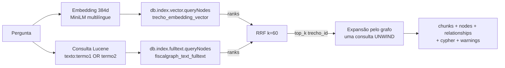

# Recuperação híbrida, embeddings e multi-hop — dev5

Camada de recuperação do FiscalGraph BR: busca vetorial e full-text sobre nós `Trecho` no Neo4j,
fusão por Reciprocal Rank Fusion (RRF), expansão pelo grafo e caminho mínimo entre empresas.
A geração da resposta em linguagem natural fica com dev1; este serviço devolve **evidências**.

> O `rrf_score` mede relevância de recuperação. **Não é** probabilidade de irregularidade, fraude ou
> culpa. Caminhos no grafo e menções textuais não provam vínculo jurídico nem responsabilidade.

## 1. Resumo das decisões

| Item | Valor |
| --- | --- |
| Modelo de embeddings | `sentence-transformers/paraphrase-multilingual-MiniLM-L12-v2` (local, sem chave de API) |
| Dimensão | 384 (validada no modelo, em cada vetor e na configuração do índice) |
| Normalização / similaridade | vetores L2-normalizados / `cosine` |
| Índice vetorial | `trecho_embedding_vector` em `Trecho.embedding` — criado pelo dev5 (`cypher/04_indice_vetorial_trecho.cypher`) |
| Índice full-text | `fiscalgraph_text_fulltext` — índice integrado de dev3, consultado só no campo `texto` e filtrado para `:Trecho` |
| Fusão | RRF, `score = Σ 1/(k + rank)`, `k = 60` |
| `top_k` | padrão 5, máximo 20 |
| Candidatos por busca | `max(4 × top_k, 20)` antes da fusão |
| Expansão | `Trecho → Fonte`, `Trecho → Sancao → Estabelecimento ← Empresa ← Socio`, `Trecho → MENCIONA → Estabelecimento` |
| Multi-hop | `shortestPath` em Cypher puro, até 6 relacionamentos, sem GDS |

## 2. Alinhamento com o schema integrado

O pacote do dev5 foi escrito antes da integração de dev3/dev4 e usava nomes que não existem no banco.
Seguindo a regra "não codificar nomes diferentes do schema integrado", o código usa os nomes da `main`:

| Pacote / contrato | Schema integrado (adotado) | Observação |
| --- | --- | --- |
| índice full-text `trecho_text_fulltext` | `fiscalgraph_text_fulltext` | Índice compartilhado (`Empresa\|Socio\|Sancao\|Trecho`). A consulta usa `texto:(...)` e `WHERE node:Trecho`. |
| índice vetorial `trecho_embedding_vector` | **não existia** | `docs/validacao-neo4j.md` atribui índice vetorial e embeddings ao dev5. Nome do pacote mantido; criado por `cypher/04_indice_vetorial_trecho.cypher`. |
| rótulo `RegistroCompliance` | `Sancao` | O campo `registro_id` do contrato continua igual. |
| `RegistroCompliance -[:REFERE_SE_A]-> Empresa` | `Sancao -[:APLICADA_A]-> Estabelecimento <-[:POSSUI_ESTABELECIMENTO]- Empresa` | Ligação por CNPJ completo exato (dev3). |
| `docs/modelo-grafo.md` | `docs/modelagem-lpg.md` | Arquivo citado no pacote não existe; usado o documento de modelagem da `main`. |

Os testes `SchemaAlignmentTests` (`tests/test_retrieval.py`) leem `cypher/01_schema_fiscalgraph.cypher` e
`cypher/04_indice_vetorial_trecho.cypher` e falham se os nomes no código divergirem dos arquivos versionados.
**Pendente:** confirmar com dev3 a inclusão do índice vetorial (arquivo 04) no fluxo oficial de schema.

## 3. Arquitetura



Arquivos:

| Arquivo | Função |
| --- | --- |
| `app/services/embeddings.py` | Fonte única de modelo, dimensão, nome e DDL do índice vetorial; `SentenceEncoder` valida 384 dimensões e valores finitos. |
| `app/services/ranking.py` | `reciprocal_rank_fusion(vector_ids, fulltext_ids, k=60)`. |
| `app/services/retrieval.py` | `retrieve_context(question, top_k=5)`, classe `GraphHybridRetriever` e CLI de consulta manual. |
| `scripts/generate_embeddings.py` | Cria/confere o índice vetorial e grava `embedding` + `embedding_model` nos `Trecho` pendentes. |
| `cypher/04_indice_vetorial_trecho.cypher` | DDL e conferência do índice vetorial. |
| `cypher/03_multi_hop.cypher` | Consultas de caminho mínimo (reais e cenário sintético). |
| `tests/test_ranking.py`, `tests/test_retrieval.py`, `tests/test_multi_hop_sintetico.py` | Testes (seção 9). |
| `requirements-dev5.txt` | `sentence-transformers>=3.0`. |

## 4. Embeddings

- O script processa só `Trecho` sem `embedding`, sem `embedding_model` ou com modelo diferente do
  configurado (`--force` reprocessa todos; `--dry-run` só conta). Trechos sem texto são ignorados e contados.
- Antes de gravar, cria o índice com `IF NOT EXISTS` e confere tipo, rótulo, propriedade, dimensão e
  similaridade via `SHOW INDEXES`. Se o índice existir com outra configuração, o script **para sem gravar**.
- Ao final espera o índice ficar `ONLINE` (`db.awaitIndex`) e verifica cobertura e dimensão mínima/máxima.
- O mesmo módulo (`app/services/embeddings.py`) é usado pelo gerador e pelo serviço, então pergunta e
  trechos são sempre codificados com o mesmo modelo e a mesma normalização.

## 5. Busca full-text

A pergunta vira uma consulta Lucene `texto:(termo1 OR termo2 ...)`:

- stopwords e palavras de pergunta em português são removidas (o analisador do índice,
  `standard-no-stop-words`, não as remove, e com OR elas trariam quase todos os trechos);
- números com separador geram duas formas: a contínua e uma frase com a pontuação original.
  Ex.: `Lei 12.846` → `12846 OR "12.846"`; `01.340.937/0001-79` → `01340937000179 OR "01.340.937/0001-79"`.
  Motivo verificado no banco: o analisador mantém `01.340.937` como um token e quebra em `/` e `-`,
  então só a frase encontra o CNPJ formatado;
- os termos só contêm letras, dígitos e `_` (frases: dígitos e `.-/`), em minúsculas: operadores
  Lucene digitados pelo usuário (`AND`, `:`, `*`, `~`, parênteses) não chegam ao índice;
- OR em vez de AND: com AND, uma pergunta em linguagem natural quase nunca tem todos os termos no mesmo trecho.

## 6. Fusão por RRF

`rrf_score(d) = 1/(60 + vector_rank) + 1/(60 + fulltext_rank)`, com a parcela omitida quando o trecho não
aparece numa das listas. Só a posição entra no cálculo: o score de cosseno e o score Lucene, que estão em
escalas diferentes, **nunca são somados**. Eles aparecem nos campos informativos `vector_score` e
`fulltext_score` para auditoria.

Regras implementadas e testadas: rank 1-based; `None` ignorado; identificador repetido numa lista conta
só a primeira vez; empates mantêm a ordem de primeira aparição (vetorial primeiro); `k` inteiro ≥ 1.
Cada busca devolve `max(4 × top_k, 20)` candidatos e o corte em `top_k` acontece depois da fusão.

## 7. Expansão pelo grafo e contrato de saída

Uma única consulta (`UNWIND $trecho_ids`) busca, para todos os trechos selecionados, os caminhos:

```text
(Trecho)-[:ORIGINADO_DE]->(Fonte)
(Trecho)-[:EXTRATO_DE]->(Sancao)-[:APLICADA_A]->(Estabelecimento)<-[:POSSUI_ESTABELECIMENTO]-(Empresa)<-[:PARTICIPA_DE]-(Socio)
(Trecho)-[:MENCIONA {status: 'CANDIDATA'}]->(Estabelecimento)
```

Os prefixos de cada caminho também são consultados, para que `Sancao`, `Estabelecimento` e `Empresa`
apareçam mesmo quando o salto seguinte não existe. Nós e relacionamentos são deduplicados (relacionamento
pelo `elementId`), sem o produto cartesiano de vários `OPTIONAL MATCH`.

Resposta (seção 3 do `CONTRATO_DADOS_E_SERVICOS.md`):

| Campo | Conteúdo |
| --- | --- |
| `query`, `retrieval_mode` | pergunta; sempre `"hybrid"` |
| `chunks[]` | `trecho_id`, `texto`, `registro_id`, `fonte_id`, `url_fonte`, `vector_rank`, `fulltext_rank`, `rrf_score` |
| `nodes[]` | `{"id": "Rotulo:chave", "label", "properties"}`; ex. `Sancao:CEIS-289814`, `Empresa:01340937` |
| `relationships[]` | `{"source", "target", "type", "properties"}` com a direção original |
| `cypher` | as três consultas executadas (vetorial, full-text, expansão) |
| `warnings` | avisos claros; lista vazia quando não há ressalva |

Campos adicionais (o contrato define o mínimo): `chunks[].vector_score`, `chunks[].fulltext_score`,
`chunks[].graph_paths` (caminhos legíveis do trecho) e `parameters` (top_k, candidatos, k do RRF, modelo,
índices e consulta Lucene usada).

Procedência: `registro_id`, `fonte_id` e `url_fonte` vêm das propriedades gravadas pelo dev4 no `Trecho`;
se estiverem vazias, vêm da `Sancao`/`Fonte` ligadas no grafo.

Propriedades mínimas: cada rótulo tem uma lista fixa de propriedades devolvidas. `embedding`, `texto`,
`mencoes_json`, `observacoes`, `fundamentacao_legal` e `capital_social` não saem em `nodes` (o texto do
trecho já está em `chunks`). **Nome de sócio só é devolvido quando `tipo_pessoa = PESSOA JURIDICA`**.

Avisos emitidos: nenhum trecho recuperado; índice vetorial ou full-text indisponível (o serviço segue com
a outra busca); nenhum `Trecho` com embedding; pergunta sem termos para full-text; nenhum termo da
pergunta nos textos (resultado só semântico); `top_k` reduzido ao máximo; presença de `MENCIONA` candidata.

### Uso por dev1/dev6

```python
from app.services.retrieval import retrieve_context

contexto = retrieve_context("Quais empresas foram declaradas inidôneas?", top_k=5)
```

`retrieve_context` lê o `.env`, cria o driver e mantém o modelo carregado entre chamadas. Para controlar
o driver (Streamlit, testes), use `GraphHybridRetriever(driver, database=...)`.

## 8. Multi-hop com `shortestPath`

`cypher/03_multi_hop.cypher`, com os CNPJs básicos reais `00356328` (CONSTRUTORA ZAG LTDA) e
`01340937` (GALVAO ENGENHARIA S/A), escolhidos pela varredura D:

| Consulta | Padrão | Resultado no recorte |
| --- | --- | --- |
| A — societário | `shortestPath((a)-[:PARTICIPA_DE*..6]-(b))` | **vazio**; 0 dos 153 pares de empresas tem caminho societário |
| B — estrutural | todos os tipos exceto `ORIGINADO_DE` | 4 relacionamentos: `Empresa:00356328 → Estabelecimento:00356328000145 → CNAE:4211101 ← Estabelecimento:01340937000179 ← Empresa:01340937` |
| C — contraprova | sem filtro de tipo | 2 relacionamentos via `Fonte:F-RFB-CNPJ` (caminho sem significado) |
| D — varredura | B para todos os pares | 14 pares: 8 com 4 relacionamentos (um CNAE em comum) e 6 com 6 (dois CNAEs) |
| E — **sintético** | `Empresa A ← Socio → Empresa B` | 2 relacionamentos `PARTICIPA_DE`; nós apagados na mesma instrução |

Por que A é vazio: `socio_id` tem escopo por empresa (`docs/modelagem-lpg.md`, 6.3) e o recorte não tem
identificador que ligue a mesma pessoa a duas empresas; nome nunca cria identidade. Por isso o cenário
societário é demonstrado com dados **sintéticos**, separados e marcados: rótulo extra `:Sintetico`,
`sintetico: true` e IDs `SINT-...` (com hífen, não são CNPJ válido). Uma única instrução cria, consulta e
apaga os nós; `tests/test_multi_hop_sintetico.py` ainda executa o bloco dentro de uma transação com rollback.

Por que `ORIGINADO_DE` fica fora: todo nó canônico aponta para uma `Fonte`, então sem filtro o caminho
mínimo entre quaisquer duas empresas é `Empresa → Fonte ← Empresa` (consulta C).

A expansão de pelo menos dois saltos também ocorre nos dados reais em toda recuperação:
`Trecho → Sancao → Estabelecimento ← Empresa ← Socio` (4 saltos).

CNAE em comum significa apenas a mesma classificação de atividade econômica, não relação entre as empresas.

## 9. Como executar e testar

Com a `.venv` ativa, Neo4j ativo, schema de dev3 aplicado e cargas de dev3 e dev4 feitas:

```bash
pip install -r requirements.txt -r requirements-dev5.txt

# Testes (ranking e serviço não exigem Neo4j nem o modelo)
python -m unittest discover -s tests -p "test_ranking.py" -v
python -m unittest discover -s tests -p "test_retrieval.py" -v
python -m unittest discover -s tests -p "test_multi_hop_sintetico.py" -v   # integração: skip sem Neo4j

# Embeddings e índice vetorial
python scripts/generate_embeddings.py --dry-run
python scripts/generate_embeddings.py --batch-size 32

# Consulta manual (texto ou JSON do contrato)
python -m app.services.retrieval "Quais empresas foram declaradas inidôneas?" --top-k 5
python -m app.services.retrieval "Quais empresas foram declaradas inidôneas?" --formato json
```

No Neo4j Browser: `cypher/04_indice_vetorial_trecho.cypher` (conferência do índice) e
`cypher/03_multi_hop.cypher` (um comando por vez).

## 10. Resultados

Ambiente: Neo4j 5.26.32 Community local (mesma versão de `docs/validacao-neo4j.md`), com o schema de dev3,
a carga canônica e a carga de `Trecho` do dev4 reproduzidas a partir da `main` (210 nós e 405
relacionamentos, iguais às evidências do time); Python 3.9.6, sentence-transformers 5.1.2, torch 2.8.0.

| Item do pacote | Resultado |
| --- | --- |
| Quantos `Trecho` tinham embedding | 0 de 54 antes; 54 de 54 depois |
| Quantos vetores gerados | 54, todos com 384 dimensões; reexecução: 0 pendentes |
| Tempo de execução | ~7 s para gerar e gravar os 54 vetores (CPU Apple M5, modelo já em cache) |
| Índice vetorial | `trecho_embedding_vector`, `VECTOR`, `ONLINE`, 384, `COSINE` |
| Consulta vetorial executada | sim (`db.index.vector.queryNodes`) |
| Consulta full-text executada | sim (`db.index.fulltext.queryNodes` em `fiscalgraph_text_fulltext`) |
| Caminho multi-hop | societário real: vazio; estrutural real: 4 relacionamentos; sintético: 2 |
| Testes | 14 (ranking) + 33 (serviço) + 3 (multi-hop sintético, com Neo4j) aprovados; os 31 do dev4 continuam aprovados |

Exemplos de perguntas (`top_k = 3`; saída completa em `docs/evidencias/dev5_recuperacao_manual.txt`):

| Pergunta | 1º resultado | Ranks vetorial / full-text | RRF | Observação |
| --- | --- | --- | --- | --- |
| Quais empresas foram declaradas inidôneas para licitar com a administração pública? | `CEIS-299637` | 1 / 1 | 0,032787 | 2º e 3º sobem por consenso (ranks 13/5 e 14/6) |
| empresa impedida de fechar contratos com o governo | `CEIS-299637` | 4 / 1 | 0,032018 | paráfrase: 2º e 3º são "Suspensão / Impedimento de Contratar" |
| Lei 12.846 publicação extraordinária da decisão condenatória | `CNEP-388379` | 1 / 1 | 0,032787 | CNEP, lei anticorrupção |
| trecho que cita o CNPJ 01.340.937/0001-79 | `CEIS-289814` | 5 / 1 | 0,031778 | CNPJ formatado encontrado pela frase; aviso de `MENCIONA` candidata |
| receita de bolo de chocolate (fora de escopo) | `CNEP-282984` | 1 / — | 0,016393 | só vetorial + aviso de baixa relevância |

Exemplo de caminho devolvido para o 1º resultado da primeira pergunta:

```text
(Trecho:47407e0fea9ecbbe3a777e85)-[:EXTRATO_DE]->(Sancao:CEIS-299637)-[:APLICADA_A]->
(Estabelecimento:00764466000163)<-[:POSSUI_ESTABELECIMENTO]-(Empresa:00764466)<-[:PARTICIPA_DE]-(Socio:SOC-19ADE7447DD9)
```

## 11. Limitações

1. **Truncamento do modelo:** o MiniLM lê no máximo 128 tokens. 40 dos 54 trechos passam disso
   (mediana 209, máximo 720), então o vetor representa o início do trecho (`descricao` e começo das
   observações/fundamentação). A busca full-text cobre o texto inteiro e compensa no modo híbrido.
   Dividir trechos longos exigiria mudar a granularidade do `Trecho`, combinado com dev4.
2. **A busca vetorial sempre devolve vizinhos**, mesmo para perguntas fora de escopo. O serviço avisa quando
   nenhum termo aparece nos textos; a decisão de abster cabe ao dev1 (`abstained`), usando esses avisos e
   os ranks, não o `rrf_score` como probabilidade.
3. **Textos repetidos:** muitos registros têm a mesma fundamentação legal (ex.: Lei 8.666, art. 87, IV) e
   produzem vetores e scores Lucene iguais. Os empates são desfeitos pela ordem de primeira aparição; os
   trechos são evidências distintas (registros diferentes), mas parecidos entre si.
4. **Acentos:** o analisador full-text não remove acentos; `inidonea` não encontra `INIDÔNEA`. A busca
   vetorial cobre parte dessas variações.
5. **Recorte pequeno:** 54 trechos e 18 empresas. Não há conjunto rotulado de relevância, então não foram
   calculadas métricas como precisão@k; os exemplos acima são qualitativos.
6. **Multi-hop societário** não existe no recorte (seção 8); o cenário sintético só ilustra a consulta.
7. **`MENCIONA`** é candidata: o serviço a devolve com `status`, offsets e aviso, sem tratá-la como vínculo.
8. **Ambiente de validação:** os resultados foram gerados numa instância local que reproduz a carga
   integrada, não na instância Docker do time. Basta rodar `scripts/generate_embeddings.py` lá para
   criar o índice e os vetores.
9. O índice vetorial e o modelo precisam ser os mesmos no gerador, no serviço e no schema. Trocar modelo ou
   dimensão exige ajuste coordenado com dev3, recriar o índice e reprocessar com `--force`.

## 12. Evidências

- `docs/evidencias/dev5_embeddings_e_indice.txt` — geração, idempotência, índice e medição de tokens.
- `docs/evidencias/dev5_recuperacao_manual.txt` — cinco consultas manuais com ranks, RRF, procedência e caminhos.
- `docs/evidencias/dev5_retrieve_context_exemplo.json` — resposta completa do contrato para uma pergunta.
- `docs/evidencias/dev5_multi_hop.txt` — saída de `cypher/03_multi_hop.cypher` e contagens antes/depois.
