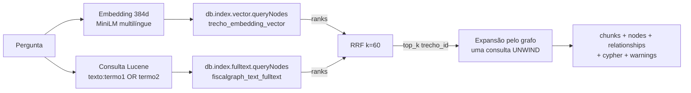

# Recuperação híbrida, embeddings e multi-hop — dev5

Camada de recuperação do FiscalGraph BR: busca vetorial e full-text sobre nós `Trecho` no Neo4j,
fusão por Reciprocal Rank Fusion (RRF), expansão pelo grafo e caminho mínimo entre empresas.
A geração da resposta em linguagem natural fica com dev1; este serviço devolve **evidências**.

> O `rrf_score` mede relevância de recuperação. **Não é** probabilidade de irregularidade, fraude ou
> culpa. Caminhos no grafo e menções textuais não provam vínculo jurídico nem responsabilidade.

## 1. Resumo das decisões

| Item | Valor |
| --- | --- |
| Modelo de embeddings | `sentence-transformers/paraphrase-multilingual-MiniLM-L12-v2` (local, sem chave de API) |
| Dimensão | 384 (validada no modelo, em cada vetor e na configuração do índice) |
| Normalização / similaridade | vetores L2-normalizados / `cosine` |
| Limite de entrada do modelo | 128 tokens: **40 dos 54 trechos são truncados** (seção 4.1) |
| Índice vetorial | `trecho_embedding_vector` em `Trecho.embedding` — criado pelo dev5 (`cypher/04_indice_vetorial_trecho.cypher`) |
| Índice full-text | `fiscalgraph_text_fulltext` — índice integrado de dev3, consultado só no campo `texto` e filtrado para `:Trecho` |
| Fusão | RRF, `score = Σ 1/(k + rank)`, `k = 60` |
| `top_k` | padrão 5, máximo 20 |
| Candidatos por busca | `max(4 × top_k, 20)` antes da fusão |
| Expansão | `Trecho → Fonte`, `Trecho → Sancao → Estabelecimento ← Empresa ← Socio`, `Trecho → MENCIONA → Estabelecimento` |
| Multi-hop | `shortestPath` em Cypher puro, até 6 relacionamentos, sem GDS |
| Caminho societário real | **inexistente no recorte** (0 de 153 pares); só há caminhos estruturais por CNAE (seção 8.1) |

## 2. Alinhamento com o schema integrado

O pacote do dev5 foi escrito antes da integração de dev3/dev4 e usava nomes que não existem no banco.
Seguindo a regra "não codificar nomes diferentes do schema integrado", o código usa os nomes da `main`:

| Pacote / contrato | Schema integrado (adotado) | Observação |
| --- | --- | --- |
| índice full-text `trecho_text_fulltext` | `fiscalgraph_text_fulltext` | Índice compartilhado (`Empresa\|Socio\|Sancao\|Trecho`). A consulta usa `texto:(...)` e `WHERE node:Trecho`. |
| índice vetorial `trecho_embedding_vector` | **não existia** | `docs/validacao-neo4j.md` atribui índice vetorial e embeddings ao dev5. Nome do pacote mantido; criado por `cypher/04_indice_vetorial_trecho.cypher`. |
| rótulo `RegistroCompliance` | `Sancao` | O campo `registro_id` do contrato continua igual. |
| `RegistroCompliance -[:REFERE_SE_A]-> Empresa` | `Sancao -[:APLICADA_A]-> Estabelecimento <-[:POSSUI_ESTABELECIMENTO]- Empresa` | Ligação por CNPJ completo exato (dev3). |
| `docs/modelo-grafo.md` | `docs/modelagem-lpg.md` | Arquivo citado no pacote não existe; usado o documento de modelagem da `main`. |

Os testes `SchemaAlignmentTests` (`tests/test_retrieval.py`) leem `cypher/01_schema_fiscalgraph.cypher` e
`cypher/04_indice_vetorial_trecho.cypher` e falham se os nomes no código divergirem dos arquivos versionados.
**Pendente:** confirmar com dev3 a inclusão do índice vetorial (arquivo 04) no fluxo oficial de schema.

## 3. Arquitetura



Arquivos:

| Arquivo | Função |
| --- | --- |
| `app/services/embeddings.py` | Fonte única de modelo, dimensão, nome e DDL do índice vetorial; `SentenceEncoder` valida 384 dimensões e valores finitos e conta tokens. |
| `app/services/ranking.py` | `reciprocal_rank_fusion(vector_ids, fulltext_ids, k=60)`. |
| `app/services/retrieval.py` | `retrieve_context(question, top_k=5)`, classe `GraphHybridRetriever` e CLI de consulta manual. |
| `app/services/contract.py` | `validate_retrieval_response(result)`: validador executável do contrato, para dev1/dev6 usarem nos testes. |
| `scripts/generate_embeddings.py` | Cria/confere o índice vetorial, mede o truncamento e grava `embedding` + `embedding_model` nos `Trecho` pendentes. |
| `scripts/audit_embedding_truncation.py` | Auditoria do truncamento: origem do limite, tokens por campo e exemplo do corte (seção 4.1). Não usa o Neo4j. |
| `cypher/04_indice_vetorial_trecho.cypher` | DDL e conferência do índice vetorial. |
| `cypher/03_multi_hop.cypher` | Consultas de caminho mínimo (reais e cenário sintético). |
| `tests/test_ranking.py`, `tests/test_retrieval.py` | Testes unitários (sem Neo4j e sem modelo). |
| `tests/test_multi_hop_sintetico.py`, `tests/test_retrieval_integracao.py` | Testes de integração com o Neo4j (skip se o banco não estiver disponível). |
| `requirements-dev5.txt` | `sentence-transformers>=3.0`. |

## 4. Embeddings

- O script processa só `Trecho` sem `embedding`, sem `embedding_model` ou com modelo diferente do
  configurado (`--force` reprocessa todos; `--dry-run` só conta). Trechos sem texto são ignorados e contados.
- Antes de gravar, cria o índice com `IF NOT EXISTS` e confere tipo, rótulo, propriedade, dimensão e
  similaridade via `SHOW INDEXES`. Se o índice existir com outra configuração, o script **para sem gravar**.
- Ao final espera o índice ficar `ONLINE` (`db.awaitIndex`) e verifica cobertura e dimensão mínima/máxima.
- O mesmo módulo (`app/services/embeddings.py`) é usado pelo gerador e pelo serviço, então pergunta e
  trechos são sempre codificados com o mesmo modelo e a mesma normalização.
- Vetores gerados em Python 3.9 (sentence-transformers 5.1.2) e em Python 3.13 (sentence-transformers 6.2.0)
  são equivalentes: cosseno mínimo 0,9999999 nos 54 trechos (`docs/evidencias/dev5_testes.txt`, seção 5).

### 4.1. Limitação: 40 dos 54 trechos ultrapassam os 128 tokens do modelo

> **Resumo:** todos os 54 trechos têm embedding, mas em **40** deles o vetor é calculado só sobre o
> começo do texto. A parte ignorada é quase sempre o fim da transcrição da lei (`fundamentacao_legal`).
> A busca full-text lê o texto inteiro dos 54 trechos e compensa no modo híbrido.

| Medida | Valor |
| --- | --- |
| Trechos que cabem inteiros (≤ 128 tokens) | **14** |
| Trechos truncados (> 128 tokens) | **40** (74%) |
| Tokens por trecho: mínimo / mediana / máximo | 27 / 209 / 720 |
| Tokens ignorados no exemplo `CEIS-132342` | 81 de 209 |

#### De onde vem o limite

- É uma configuração do próprio modelo, definida pelos autores no arquivo `sentence_bert_config.json`
  que acompanha o modelo: `"max_seq_length": 128`. O sentence-transformers corta todo texto nesse
  tamanho antes de gerar o vetor, **sem aviso**.
- A arquitetura por baixo (um BERT de 12 camadas, `config.json`) aceita até 512 posições
  (`max_position_embeddings: 512`). Essa é a capacidade máxima, não o tamanho de trabalho: o modelo foi
  preparado para frases e parágrafos curtos, e os autores fixaram 128.
- Duas dessas 128 posições são tokens especiais de início e fim; sobram **126** para o conteúdo.

#### O que é um token

Token não é palavra: é um pedaço de palavra tirado do vocabulário do modelo (250.037 pedaços). Nos
trechos, a mediana é de 94 palavras e **2,18 tokens por palavra**. Texto em caixa alta rende mais
pedaços, porque é raro nos textos com que o vocabulário foi construído:

| Palavra | Tokens | Palavra | Tokens |
| --- | --- | --- | --- |
| administração | 1 | ADMINISTRAÇÃO | 2 |
| inidoneidade | 3 | INIDONEIDADE | 4 |
| contratado | 1 | CONTRATADO | 3 |

A `fundamentacao_legal` vem da fonte (CGU) em caixa alta, por isso consome muitos tokens.

#### Por que 40 trechos passam do limite

O dev4 monta cada trecho juntando, nesta ordem, `descricao`, `observacoes` e `fundamentacao_legal`
(`compose_text` em `pipeline/text_to_graph/extractor.py`). Medindo cada campo nos 54 registros:

| Campo | Tokens (mediana) | Máximo | Observação |
| --- | --- | --- | --- |
| `descricao` | 9 | 23 | tipo da sanção, sempre curto |
| `observacoes` | 0 | 266 | vazio em 32 dos 54 |
| `fundamentacao_legal` | **198** | **691** | transcrição do artigo da lei, em caixa alta |

- Em **35 dos 54** registros a `fundamentacao_legal` sozinha já passa do limite.
- Sem esse campo, só **7** trechos passariam de 128, em vez de 40.
- Os 54 textos recompostos pela auditoria são idênticos aos de `trechos.jsonl`, então a análise
  corresponde exatamente ao que virou embedding.

#### Exemplo do corte

Registro `CEIS-132342` (94 palavras, 209 tokens, 81 ignorados):

- **Última parte que o modelo lê:** "…ENQUANTO PERDURAREM OS MOTIVOS DETERMINANTES DA PUNIÇÃO OU ATÉ QUE SEJA PROMOVIDA"
- **Início do que é ignorado:** "A REABILITAÇÃO PERANTE A PRÓPRIA AUTORIDADE QUE APLICOU A PENALIDADE, QUE SERÁ CONCEDIDA…"

#### Impacto na recuperação

- **O que entra no vetor:** em geral, o tipo da sanção, as observações (quando existem) e o começo da
  fundamentação, que traz a lei e o artigo (ex.: "LEI 8666 - ART. 87, IV"). É a parte que mais
  diferencia um registro de outro.
- **O que fica de fora:** o restante da transcrição da lei, texto que se repete em muitos registros.
- Uma pergunta cujo conteúdo só aparece na parte ignorada **não é encontrada pela busca vetorial**,
  mas **é encontrada pela busca full-text**, que indexa o texto inteiro, e entra no resultado pelo RRF.

#### Opções avaliadas (nenhuma aplicada)

| Opção | Efeito | Custo / risco |
| --- | --- | --- |
| Aumentar `max_seq_length` para até 512 | o vetor passa a considerar mais texto; dimensão 384 e índice não mudam | o modelo não foi ajustado para textos longos: a qualidade precisaria ser avaliada; reprocessar com `--force` |
| Dividir trechos longos em janelas de até 128 tokens | cobre o texto inteiro | muda a granularidade do `Trecho` (dev4) e o contrato (vários vetores por trecho) |
| Trocar por um modelo de contexto maior | cobre mais texto | muda a dimensão: recriar o índice e alinhar com dev3 |

Decisão: manter como está. A parte perdida é sobretudo texto legal repetido, a busca full-text cobre
o texto inteiro e, sem um conjunto de perguntas com respostas esperadas, não há como medir se alguma
das opções melhoraria a recuperação.

#### Como reproduzir

```bash
python scripts/audit_embedding_truncation.py    # análise completa; não usa o Neo4j
```

O gerador também mede o truncamento sempre que processa trechos (primeira execução ou `--force`):

```text
Truncamento: 40/54 trechos acima de 128 tokens (mín. 27, mediana 209, máx. 720); nesses, o embedding representa só os primeiros 128 tokens.
```

Evidências: `docs/evidencias/dev5_truncamento_embeddings.txt` e `docs/evidencias/dev5_embeddings_e_indice.txt`.

## 5. Busca full-text

A pergunta vira uma consulta Lucene `texto:(termo1 OR termo2 ...)`:

- stopwords e palavras de pergunta em português são removidas (o analisador do índice,
  `standard-no-stop-words`, não as remove, e com OR elas trariam quase todos os trechos);
- números com separador geram duas formas: a contínua e uma frase com a pontuação original.
  Ex.: `Lei 12.846` → `12846 OR "12.846"`; `01.340.937/0001-79` → `01340937000179 OR "01.340.937/0001-79"`.
  Motivo verificado no banco: o analisador mantém `01.340.937` como um token e quebra em `/` e `-`,
  então só a frase encontra o CNPJ formatado;
- os termos só contêm letras, dígitos e `_` (frases: dígitos e `.-/`), em minúsculas: operadores
  Lucene digitados pelo usuário (`AND`, `:`, `*`, `~`, parênteses) não chegam ao índice;
- OR em vez de AND: com AND, uma pergunta em linguagem natural quase nunca tem todos os termos no mesmo trecho.

## 6. Fusão por RRF

`rrf_score(d) = 1/(60 + vector_rank) + 1/(60 + fulltext_rank)`, com a parcela omitida quando o trecho não
aparece numa das listas. Só a posição entra no cálculo: o score de cosseno e o score Lucene, que estão em
escalas diferentes, **nunca são somados**. Eles aparecem nos campos informativos `vector_score` e
`fulltext_score` para auditoria.

O maior valor possível é `2/61 ≈ 0,0328` (1º lugar nas duas buscas), devolvido em
`parameters.rrf_max_score`. Um trecho em 1º lugar em só uma das buscas recebe metade disso.

Regras implementadas e testadas: rank 1-based; `None` ignorado; identificador repetido numa lista conta
só a primeira vez; empates mantêm a ordem de primeira aparição (vetorial primeiro); `k` inteiro ≥ 1.
Cada busca devolve `max(4 × top_k, 20)` candidatos e o corte em `top_k` acontece depois da fusão.

## 7. Contrato de `retrieve_context`

### 7.1. Saída

Uma única consulta (`UNWIND $trecho_ids`) busca, para todos os trechos selecionados, os caminhos:

```text
(Trecho)-[:ORIGINADO_DE]->(Fonte)
(Trecho)-[:EXTRATO_DE]->(Sancao)-[:APLICADA_A]->(Estabelecimento)<-[:POSSUI_ESTABELECIMENTO]-(Empresa)<-[:PARTICIPA_DE]-(Socio)
(Trecho)-[:MENCIONA {status: 'CANDIDATA'}]->(Estabelecimento)
```

Os prefixos de cada caminho também são consultados, para que `Sancao`, `Estabelecimento` e `Empresa`
apareçam mesmo quando o salto seguinte não existe. Nós e relacionamentos são deduplicados (relacionamento
pelo `elementId`), sem o produto cartesiano de vários `OPTIONAL MATCH`.

Campos exigidos pela seção 3 do `CONTRATO_DADOS_E_SERVICOS.md`, todos presentes:

| Campo | Tipo | Conteúdo |
| --- | --- | --- |
| `query` | `str` | pergunta recebida |
| `retrieval_mode` | `str` | sempre `"hybrid"` |
| `chunks[]` | `list[dict]` | `trecho_id: str`, `texto: str`, `registro_id: str \| None`, `fonte_id: str \| None`, `url_fonte: str \| None`, `vector_rank: int \| None`, `fulltext_rank: int \| None`, `rrf_score: float`; ordenados por `rrf_score` decrescente |
| `nodes[]` | `list[dict]` | `{"id": "Rotulo:chave", "label": str, "properties": dict}`; ex. `Sancao:CEIS-289814`, `Empresa:01340937` |
| `relationships[]` | `list[dict]` | `{"source": id, "target": id, "type": str, "properties": dict}`, com a direção original |
| `cypher` | `str` | as três consultas executadas (vetorial, full-text, expansão) |
| `warnings` | `list[str]` | avisos claros; lista vazia quando não há ressalva |

Campos adicionais (o contrato define o mínimo; consumidores devem ignorar o que não usam):
`chunks[].vector_score`, `chunks[].fulltext_score`, `chunks[].graph_paths` (caminhos legíveis do trecho) e
`parameters` (`top_k`, `candidate_k`, `rrf_k`, `rrf_max_score`, modelo, índices e consulta Lucene usada).

Procedência: `registro_id`, `fonte_id` e `url_fonte` vêm das propriedades gravadas pelo dev4 no `Trecho`;
se estiverem vazias, vêm da `Sancao`/`Fonte` ligadas no grafo. No recorte real, os três campos estão
preenchidos em todos os trechos devolvidos (teste de integração).

Propriedades mínimas: cada rótulo tem uma lista fixa de propriedades devolvidas. `embedding`, `texto`,
`mencoes_json`, `observacoes`, `fundamentacao_legal` e `capital_social` não saem em `nodes` (o texto do
trecho já está em `chunks`). **Nome de sócio só é devolvido quando `tipo_pessoa = PESSOA JURIDICA`**.

Avisos emitidos: nenhum trecho recuperado; índice vetorial ou full-text indisponível (o serviço segue com
a outra busca); nenhum `Trecho` com embedding; pergunta sem termos para full-text; nenhum termo da
pergunta nos textos (resultado só semântico); `top_k` reduzido ao máximo; presença de `MENCIONA` candidata.

### 7.2. Compatibilidade com dev1 e dev6

**Situação verificada em 2026-11-10:** a branch `dev1` contém só a preparação inicial do ambiente (já
integrada à `main`) e não há branch `dev6`. Ainda não existe código consumidor; por isso a compatibilidade
foi verificada contra o contrato (seções 3 e 4 do `CONTRATO_DADOS_E_SERVICOS.md`) com testes executáveis:

- `validate_retrieval_response` (`app/services/contract.py`) checa tipos, ordem dos chunks, ranks,
  ids únicos, arestas apontando para nós existentes, aviso quando não há evidência e serialização em JSON;
- o validador passa nos cenários sintéticos (normal, sem evidência, só full-text, só vetorial) e em
  respostas reais do banco para cinco perguntas (`tests/test_retrieval_integracao.py`);
- `ContractCompatibilityTests` monta a resposta final do dev1 (seção 4) usando **apenas** a saída do dev5,
  sem consulta extra ao banco, conforme o mapeamento abaixo.

Mapeamento para a resposta final do dev1 (seção 4 do contrato):

| Campo do dev1 | Origem na resposta do dev5 |
| --- | --- |
| `answer` | gerado pelo dev1 a partir de `chunks[].texto` |
| `cypher` | `cypher`, sem alteração |
| `sources[]` (`id`, `label`, `url`) | um por chunk: `id = registro_id` (ou `trecho_id` se ausente), `label = "Sancao"` (ou `"Trecho"`), `url = url_fonte`; órgão, competência e data de coleta estão no nó `Fonte` em `nodes` |
| `nodes`, `relationships` | sem alteração |
| `retrieval_relevance` | `chunks[0].rrf_score / parameters.rrf_max_score`: 1,0 = 1º nas duas buscas; 0,5 = 1º em só uma; `None` sem chunks. É relevância, não probabilidade |
| `abstained` | `True` quando `chunks` vem vazio. Recomendado também quando todos os chunks têm `fulltext_rank = None` e há o aviso "Nenhum termo da pergunta…" (só similaridade semântica) |
| `warnings` | repassar e acrescentar os avisos do dev1 |

Para a interface (dev6):

- `nodes[].id` é estável entre chamadas (`Rotulo:chave`) e pode ser o id do nó na visualização;
  `label` serve para cor/ícone e `properties` para o detalhe;
- toda aresta tem `source` e `target` presentes em `nodes` (validado); `type` é o rótulo da aresta;
- `MENCIONA` traz `properties.status = "CANDIDATA"` e deve ser exibida como candidata, não como vínculo;
- `chunks[].graph_paths` traz o caminho em texto, pronto para explicação;
- a resposta inteira é serializável em JSON (validado), então pode ir para `st.session_state` ou `st.json`.

Ambiente: a suíte passa em Python 3.9.6 (driver neo4j 5.28) e em Python 3.13.18 com as versões que o pip
resolve hoje (driver neo4j 6.4, sentence-transformers 6.2, transformers 5.22, torch 2.15).

Uso:

```python
from app.services.retrieval import retrieve_context
from app.services.contract import validate_retrieval_response

contexto = retrieve_context("Quais empresas foram declaradas inidôneas?", top_k=5)
assert validate_retrieval_response(contexto) == []
```

`retrieve_context` lê o `.env`, cria o driver e mantém o modelo carregado entre chamadas. Para controlar
o driver (Streamlit, testes), use `GraphHybridRetriever(driver, database=...)`.

## 8. Multi-hop com `shortestPath`

### 8.1. Caminho societário × caminho estrutural por CNAE

> **Resumo:** no recorte **não existe nenhum caminho societário** entre empresas (0 de 153 pares). Os 14
> caminhos reais encontrados são **estruturais, por CNAE**: mostram só que duas empresas declaram a mesma
> atividade econômica. Não indicam sócio, controle ou relação comercial.

| | Caminho societário | Caminho estrutural por CNAE |
| --- | --- | --- |
| Padrão | `Empresa ← PARTICIPA_DE ← Socio → PARTICIPA_DE → Empresa` | `Empresa → POSSUI_ESTABELECIMENTO → Estabelecimento → EXERCE_CNAE → CNAE ← … ← Empresa` |
| O que indicaria | o mesmo sócio registrado em duas empresas | as duas empresas declaram a mesma atividade econômica |
| Existe no recorte? | **Não**: 0 de 153 pares de empresas | **Sim**: 14 pares (8 com 4 relacionamentos, 6 com 6) |
| Por quê | regra de identidade do sócio e ausência de casos nos dados (abaixo) | 8 códigos CNAE são declarados por mais de uma empresa |
| Interpretação | seria um vínculo societário (que, sozinho, ainda não prova irregularidade) | **não** é vínculo societário, de controle ou comercial |
| Como foi demonstrado | consulta A vazia + diagnóstico E com dados reais; cenário **sintético** G | consultas B, D e F com CNPJs reais |

#### Por que não há caminho societário

São dois motivos independentes:

1. **Regra de identidade do sócio (modelagem).** O `socio_id` é gerado por
   `generate_socio_id` em `scripts/build_canonical_dataset.py` como
   `"SOC-" + sha256("cnpj_basico:índice:NOME")[:12]`. Como o `cnpj_basico` da empresa entra no cálculo,
   a mesma pessoa registrada em duas empresas vira **dois nós `Socio` diferentes**, e um caminho
   `Empresa ← Socio → Empresa` não pode se formar. A decisão é intencional (`docs/modelagem-lpg.md`, 6.3):
   sem CPF e sem identificador nacional do sócio, não há como afirmar que dois registros são a mesma
   pessoa, e nome não cria identidade (homônimos são comuns).
2. **Dados do recorte.** Mesmo com outra regra de identidade, o recorte de 18 empresas não tem nenhum
   caso. Verificações da seção E de `cypher/03_multi_hop.cypher` (só contagens, sem exibir nomes):

| Verificação | Resultado |
| --- | --- |
| Quantas empresas cada nó `Socio` alcança | 26 sócios, **todos com 1 empresa** |
| Nomes de sócio presentes em mais de uma empresa (só diagnóstico; o projeto não liga por nome) | **0** |
| Sócios pessoa jurídica que são empresas do próprio recorte | 1 sócio PJ, **0** no recorte (o QSA não traz o CNPJ do sócio PJ) |
| Pares de empresas com caminho só por `PARTICIPA_DE` | **0 de 153** |

Portanto a ausência vem dos dados e da regra de identidade, **não de erro na consulta**: o mesmo
`shortestPath` encontra o caminho de 2 relacionamentos no cenário sintético G. A ausência também vale só
para o recorte: ela não prova que essas empresas não tenham sócios em comum na base completa da Receita
(`docs/modelagem-lpg.md`, princípio 8: ausência não é evidência negativa). Com um recorte maior e um
identificador de sócio comparável entre empresas (por exemplo, o CNPJ do sócio pessoa jurídica), a
consulta A poderia ter resultado.

#### O que os caminhos por CNAE significam

CNAE é o código oficial (IBGE/CONCLA) da atividade econômica que cada estabelecimento declara à Receita.
Dois estabelecimentos com o mesmo código apontam para o mesmo nó `CNAE`, e isso cria o caminho. No recorte,
8 CNAEs são declarados por mais de uma empresa (consulta F):

| CNAE | Descrição | Empresas |
| --- | --- | --- |
| 9430800 | Atividades de associações de defesa de direitos sociais | 00000104, 00000113, 00000145 |
| 4120400 | Construção de edifícios | 01278154, 01340937 |
| 4211101 | Construção de rodovias e ferrovias | 00356328, 01340937 |
| 4299599 | Outras obras de engenharia civil não especificadas anteriormente | 00764466, 01340937 |
| 4321500 | Instalação e manutenção elétrica | 00073357, 01278154 |
| 8511200 | Educação infantil - creche | 00000104, 00090616 |
| 9493600 | Atividades de organizações associativas ligadas à cultura e à arte | 00000113, 00000145 |
| 9499500 | Atividades associativas não especificadas anteriormente | 00000113, 00000145 |

Nenhum dos 14 caminhos estruturais passa por um `Socio` (coluna `socios_no_caminho = 0` na varredura D).
Um caminho por CNAE diz apenas que as empresas atuam na mesma classificação de atividade; não indica
sócio comum, grupo econômico, consórcio, relação comercial nem participação conjunta em licitação.

#### Como apresentar esses resultados (dev1 e dev6)

| Correto | Incorreto |
| --- | --- |
| "00356328 e 01340937 declaram a mesma atividade econômica (CNAE 4211101 – Construção de rodovias e ferrovias)." | "00356328 e 01340937 estão ligadas" ou "são relacionadas" |
| "Não foi encontrado vínculo societário entre as empresas no recorte analisado." | "As empresas não têm sócios em comum." |
| Exibir a aresta `EXERCE_CNAE` e o nó `CNAE` no caminho | Desenhar uma aresta direta entre as duas empresas |

### 8.2. Consultas e resultados

`cypher/03_multi_hop.cypher`, com os CNPJs básicos reais `00356328` (CONSTRUTORA ZAG LTDA) e
`01340937` (GALVAO ENGENHARIA S/A), escolhidos pela varredura D:

| Consulta | Padrão | Resultado no recorte |
| --- | --- | --- |
| A — societário | `shortestPath((a)-[:PARTICIPA_DE*..6]-(b))` | **vazio**; 0 dos 153 pares de empresas tem caminho societário |
| B — estrutural | todos os tipos exceto `ORIGINADO_DE` | 4 relacionamentos: `Empresa:00356328 → Estabelecimento:00356328000145 → CNAE:4211101 ← Estabelecimento:01340937000179 ← Empresa:01340937` |
| C — contraprova | sem filtro de tipo | 2 relacionamentos via `Fonte:F-RFB-CNPJ` (caminho sem significado) |
| D — varredura | B para todos os pares | 14 pares: 8 com 4 relacionamentos (um CNAE em comum) e 6 com 6 (dois CNAEs); nenhum passa por `Socio` |
| E1–E3 — diagnóstico societário | contagens de sócios, nomes e sócios PJ | 26 sócios com 1 empresa cada; 0 nomes em mais de uma empresa; 1 sócio PJ, 0 no recorte |
| F — CNAEs compartilhados | CNAEs declarados por mais de uma empresa | 8 CNAEs (tabela da seção 8.1) |
| G — **sintético** | `Empresa A ← Socio → Empresa B` | 2 relacionamentos `PARTICIPA_DE`; nós apagados na mesma instrução |

O CNAE 4211101 do caminho B é "Construção de rodovias e ferrovias": as duas empresas declaram essa
atividade, e nada além disso pode ser concluído desse caminho.

O cenário sintético é separado e marcado: rótulo extra `:Sintetico`, `sintetico: true` e IDs `SINT-...`
(com hífen, não são CNPJ válido). Uma única instrução cria, consulta e apaga os nós;
`tests/test_multi_hop_sintetico.py` ainda executa o bloco dentro de uma transação com rollback.

Por que `ORIGINADO_DE` fica fora: todo nó canônico aponta para uma `Fonte`, então sem filtro o caminho
mínimo entre quaisquer duas empresas é `Empresa → Fonte ← Empresa` (consulta C).

A expansão de pelo menos dois saltos também ocorre nos dados reais em toda recuperação:
`Trecho → Sancao → Estabelecimento ← Empresa ← Socio` (4 saltos).

## 9. Como executar e testar

Com a `.venv` ativa, Neo4j ativo, schema de dev3 aplicado e cargas de dev3 e dev4 feitas:

```bash
pip install -r requirements.txt -r requirements-dev5.txt

# Testes unitários (não exigem Neo4j nem o modelo)
python -m unittest discover -s tests -p "test_ranking.py" -v
python -m unittest discover -s tests -p "test_retrieval.py" -v

# Testes de integração (skip automático sem Neo4j/NEO4J_PASSWORD)
python -m unittest discover -s tests -p "test_multi_hop_sintetico.py" -v
python -m unittest discover -s tests -p "test_retrieval_integracao.py" -v   # exige embeddings gerados

# Embeddings e índice vetorial
python scripts/generate_embeddings.py --dry-run
python scripts/generate_embeddings.py --batch-size 32
python scripts/audit_embedding_truncation.py      # auditoria do limite de 128 tokens

# Consulta manual (texto ou JSON do contrato)
python -m app.services.retrieval "Quais empresas foram declaradas inidôneas?" --top-k 5
python -m app.services.retrieval "Quais empresas foram declaradas inidôneas?" --formato json
```

No Neo4j Browser: `cypher/04_indice_vetorial_trecho.cypher` (conferência do índice) e
`cypher/03_multi_hop.cypher` (um comando por vez).

## 10. Resultados

Ambiente: Neo4j 5.26.32 Community local (mesma versão de `docs/validacao-neo4j.md`), com o schema de dev3,
a carga canônica e a carga de `Trecho` do dev4 reproduzidas a partir da `main` (210 nós e 405
relacionamentos, iguais às evidências do time).

### 10.1. Testes da suíte Dev5

Executados em 2026-11-10; saída completa em `docs/evidencias/dev5_testes.txt`.

| Módulo | Tipo | Testes | Python 3.9.6 | Python 3.13.18 |
| --- | --- | --- | --- | --- |
| `tests/test_ranking.py` | unitário (RRF) | 14 | OK | OK |
| `tests/test_retrieval.py` | unitário (serviço, contrato, compatibilidade dev1/dev6, schema, tokens, auditoria de truncamento) | 43 | OK | OK |
| `tests/test_multi_hop_sintetico.py` | arquivo Cypher + integração (cenário sintético com rollback) | 3 | OK | OK |
| `tests/test_retrieval_integracao.py` | integração com banco e modelo reais | 5 | OK | OK |
| **Total Dev5** | | **65** | **65 OK** | **65 OK** |
| `tests/test_text_to_graph.py` (dev4, regressão) | unitário | 31 | OK | OK |

Sem Neo4j configurado, a suíte completa roda 90 testes e as 2 classes de integração são ignoradas (skip),
sem falha.

### 10.2. Embeddings e buscas

| Item do pacote | Resultado |
| --- | --- |
| Quantos `Trecho` tinham embedding | 0 de 54 antes; 54 de 54 depois |
| Quantos vetores gerados | 54, todos com 384 dimensões; reexecução: 0 pendentes |
| Trechos truncados pelo limite do modelo | 40 de 54 (seção 4.1) |
| Tempo de execução | ~7 s para gerar e gravar os 54 vetores (CPU Apple M5, modelo já em cache) |
| Índice vetorial | `trecho_embedding_vector`, `VECTOR`, `ONLINE`, 384, `COSINE` |
| Consulta vetorial executada | sim (`db.index.vector.queryNodes`) |
| Consulta full-text executada | sim (`db.index.fulltext.queryNodes` em `fiscalgraph_text_fulltext`) |
| Contrato | validador sem violações nas respostas reais e no JSON de exemplo |
| Caminho multi-hop | societário real: vazio; estrutural real por CNAE: 4 relacionamentos; sintético: 2 |

Exemplos de perguntas (`top_k = 3`; saída completa em `docs/evidencias/dev5_recuperacao_manual.txt`):

| Pergunta | 1º resultado | Ranks vetorial / full-text | RRF | Observação |
| --- | --- | --- | --- | --- |
| Quais empresas foram declaradas inidôneas para licitar com a administração pública? | `CEIS-299637` | 1 / 1 | 0,032787 | 2º e 3º sobem por consenso (ranks 13/5 e 14/6) |
| empresa impedida de fechar contratos com o governo | `CEIS-299637` | 4 / 1 | 0,032018 | paráfrase: 2º e 3º são "Suspensão / Impedimento de Contratar" |
| Lei 12.846 publicação extraordinária da decisão condenatória | `CNEP-388379` | 1 / 1 | 0,032787 | CNEP, lei anticorrupção |
| trecho que cita o CNPJ 01.340.937/0001-79 | `CEIS-289814` | 5 / 1 | 0,031778 | CNPJ formatado encontrado pela frase; aviso de `MENCIONA` candidata |
| receita de bolo de chocolate (fora de escopo) | `CNEP-282984` | 1 / — | 0,016393 | só vetorial + aviso de baixa relevância |

Exemplo de caminho devolvido para o 1º resultado da primeira pergunta:

```text
(Trecho:47407e0fea9ecbbe3a777e85)-[:EXTRATO_DE]->(Sancao:CEIS-299637)-[:APLICADA_A]->
(Estabelecimento:00764466000163)<-[:POSSUI_ESTABELECIMENTO]-(Empresa:00764466)<-[:PARTICIPA_DE]-(Socio:SOC-19ADE7447DD9)
```

## 11. Limitações

1. **Truncamento do modelo:** 40 dos 54 trechos ultrapassam o limite de 128 tokens, fixado na configuração
   do modelo (`sentence_bert_config.json`), e têm embedding calculado só sobre o início do texto. A causa
   principal é a `fundamentacao_legal` (mediana de 198 tokens, em caixa alta): sem ela, só 7 trechos
   passariam do limite. A busca full-text cobre o texto inteiro (seção 4.1).
2. **Sem caminho societário real no recorte:** nenhum dos 153 pares das 18 empresas tem sócio em comum.
   O `socio_id` inclui o `cnpj_basico`, então cada nó `Socio` pertence a uma só empresa; e, no recorte,
   nenhum sócio aparece em duas empresas nem por nome. Os 14 caminhos reais entre empresas são
   estruturais, por CNAE, e significam só atividade econômica em comum, não vínculo (seção 8.1). O caminho
   societário foi demonstrado apenas com dados sintéticos.
3. **A busca vetorial sempre devolve vizinhos**, mesmo para perguntas fora de escopo. O serviço avisa quando
   nenhum termo aparece nos textos; a decisão de abster cabe ao dev1 (`abstained`), usando esses avisos e
   os ranks, não o `rrf_score` como probabilidade.
4. **Textos repetidos:** muitos registros têm a mesma fundamentação legal (ex.: Lei 8.666, art. 87, IV) e
   produzem vetores e scores Lucene iguais. Os empates são desfeitos pela ordem de primeira aparição; os
   trechos são evidências distintas (registros diferentes), mas parecidos entre si.
5. **Acentos:** o analisador full-text não remove acentos; `inidonea` não encontra `INIDÔNEA`. A busca
   vetorial cobre parte dessas variações.
6. **Recorte pequeno:** 54 trechos e 18 empresas. Não há conjunto rotulado de relevância, então não foram
   calculadas métricas como precisão@k; os exemplos acima são qualitativos.
7. **`MENCIONA`** é candidata: o serviço a devolve com `status`, offsets e aviso, sem tratá-la como vínculo.
8. **Consumidores ainda não existem:** a compatibilidade com dev1/dev6 foi verificada contra o contrato
   (seção 7.2), não contra código deles. Recomenda-se que usem `validate_retrieval_response` nos testes.
9. **Ambiente de validação:** os resultados foram gerados numa instância local que reproduz a carga
   integrada, não na instância Docker do time. Basta rodar `scripts/generate_embeddings.py` lá para
   criar o índice e os vetores.
10. O índice vetorial e o modelo precisam ser os mesmos no gerador, no serviço e no schema. Trocar modelo ou
    dimensão exige ajuste coordenado com dev3, recriar o índice e reprocessar com `--force`.

## 12. Evidências

- `docs/evidencias/dev5_testes.txt` — execução da suíte Dev5 em Python 3.9 e 3.13, regressão do dev4,
  comportamento sem Neo4j e equivalência dos embeddings entre ambientes.
- `docs/evidencias/dev5_truncamento_embeddings.txt` — auditoria do limite de 128 tokens: origem do limite,
  tokens por campo, caixa alta e exemplo do corte.
- `docs/evidencias/dev5_embeddings_e_indice.txt` — geração, truncamento, idempotência e índice.
- `docs/evidencias/dev5_recuperacao_manual.txt` — cinco consultas manuais com ranks, RRF, procedência e caminhos.
- `docs/evidencias/dev5_retrieve_context_exemplo.json` — resposta completa do contrato para uma pergunta.
- `docs/evidencias/dev5_multi_hop.txt` — saída de `cypher/03_multi_hop.cypher` (caminhos, diagnóstico
  societário, CNAEs compartilhados e cenário sintético) e contagens antes/depois.
